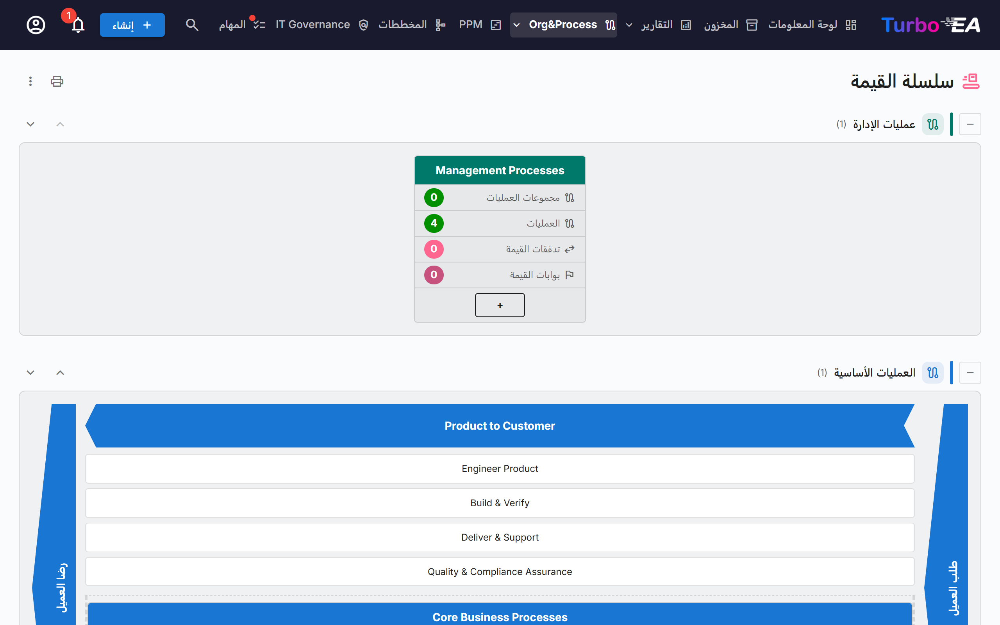
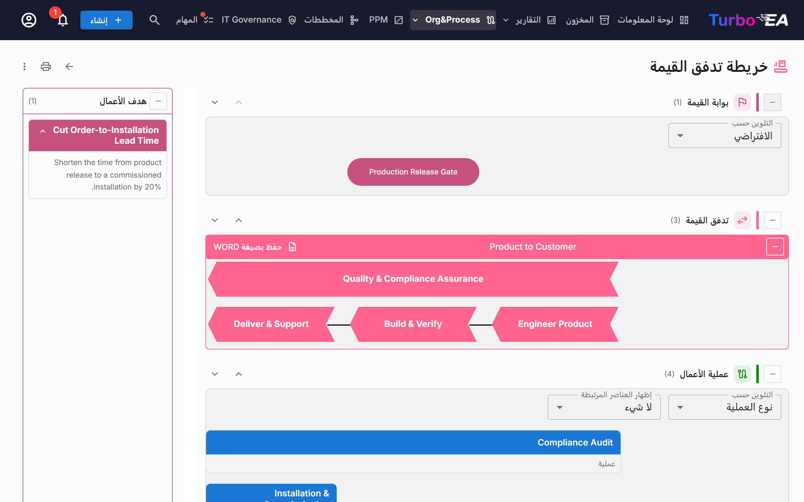

# سلسلة القيمة وخرائط تدفق القيمة

تعرض صفحتا **سلسلة القيمة** و**خريطة تدفق القيمة** للقراءة فقط كيف تخلق المؤسسة القيمة: ما فئات العمليات الموجودة، وكيف تمتد تدفقات القيمة الأساسية من طلب العميل إلى رضاه، وما العمليات والقدرات والأهداف وبوابات القيمة التي تقف خلف كل تدفق. تُرسم الصفحتان من بطاقاتك الحالية، ولا يُدخَل أي شيء في الصفحتين نفسيهما.

!!! note
    تنتمي الصفحتان إلى مجال [BPM](bpm.md). يمكن للمسؤول إيقافهما من **الإدارة ← الإعدادات ← وحدة BPM** (انظر [الإعدادات العامة](../admin/settings.md#وحدة-bpm))، وتُخفيان أيضًا ما دامت BPM نفسها متوقفة. يتطلب فتح الصفحتين الإذن `bpm.value_chain`.

افتحهما من **Org&Process ← سلسلة القيمة**.

## صفحة سلسلة القيمة

تُرتّب الصفحة أربعة نطاقات فوق بعضها، نطاق لكل **نوع عملية**:

| النطاق | المحتوى |
|--------|---------|
| **عمليات الإدارة** | التخطيط والحوكمة والرقابة |
| **العمليات الأساسية** | التدفقات التي تخلق القيمة، مرسومة على شكل «بيت» (انظر أدناه) |
| **عمليات الدعم** | الأنشطة التي تُبقي العمليات الأساسية قائمة |
| **عمليات بلا نوع** | فئات العمليات التي لم يُحدَّد *نوع العملية* لها بعد |

يعرض كل نطاق عدد مربعاته بين قوسين. استخدم زر **طيّ** على جانب عنوان النطاق لطيّه. تنقل الأسهم لأعلى ولأسفل النطاق؛ ويُشارَك الترتيب مع [مستكشف عمليات BPM](bpm.md#مستكشف-العمليات)، ولا يرى الأسهم سوى المستخدمين الذين يمكنهم تغيير الإعدادات (`admin.settings`).

### مربعات فئات العمليات

كل **فئة عمليات** (بطاقة عملية تجارية من النوع الفرعي *فئة العملية*) هي مربع. يعرض ترويسته اسم الفئة، وتحته أربعة عدّادات تُحسب عبر التسلسل الهرمي كله تحت الفئة:

- **مجموعات العمليات**
- **العمليات**
- **تدفقات القيمة**: التدفقات التي تحققها عمليات الفئة
- **بوابات القيمة**: البوابات المرتبطة بتلك التدفقات

انقر ترويسة المربع **لفتح خريطة تدفق القيمة** لهذه الفئة.

### بيت العمليات الأساسية

يُرسم نطاق العمليات الأساسية على شكل بيت: حدّ **طلب العميل** على أحد الجانبين، وحدّ **رضا العميل** على الجانب الآخر، وبينهما سهم لكل تدفق قيمة أساسي من المستوى الأعلى. تحت كل سهم تظهر تدفقات القيمة الفرعية له على شكل مربعات، ثم العمليات المرتبطة مباشرة بتدفق المستوى الأعلى على شكل مربعات عمليات. انقر سهمًا أو مربعًا لفتح بطاقته.

لا يسرد البيت إلا تدفقات المستوى الأعلى المعلَّمة **أساسي**. وإن لم يوجد أي منها، تنبّه الصفحة إلى أنه لم يُعرَّف أي تدفق قيمة أساسي.

## خريطة تدفق القيمة

افتح الخريطة من مربع فئة. يتضمن العنوان الفئة (`/value-chain/value-stream?category=…`)، فيمكن حفظ الخريطة كإشارة مرجعية أو مشاركتها. إن لم تكن الفئة موجودة أو لم تستطع رؤيتها، تذكر الصفحة ذلك؛ وإن لم ترتبط الفئة بأي تدفق قيمة بعد، يظهر تلميح بدل خريطة فارغة.

لكل تدفق قيمة في الفئة ترسم الخريطة حتى أربعة نطاقات أفقية من الأعلى إلى الأسفل:

| النطاق | ما يعرضه |
|--------|----------|
| **بوابة القيمة** | بوابات القيمة (أهداف من النوع الفرعي *بوابة القيمة*) المرتبطة بالتدفق، على شكل حبوب محاذية للمراحل التي تخصّها |
| **تدفق القيمة** | التدفق على شكل صف من الأسهم، سهم لكل مرحلة (تدفقاته الفرعية)، بالترتيب الذي تحدده علاقات *يخلف*. تُرسم المراحل المعلَّمة **شامل** بمعزل عن التسلسل |
| **عملية الأعمال** | مجموعات العمليات والعمليات التي تحقق كل مرحلة، عمود لكل مرحلة، موزعة في صفوف بحسب **ترتيب المستوى** |
| **قدرة الأعمال** | قدرات الأعمال المرتبطة بكل مرحلة |

تسرد لوحة **هدف الأعمال** أهداف النوع الفرعي *هدف العمل* التي يكون التدفق هدفًا لها.

### العمل مع الخريطة

- **طيّ النطاقات وإعادة ترتيبها.** لكل نطاق زر طيّ وأسهم لأعلى/لأسفل. يُحفَظ الترتيب في متصفحك فقط. يبدأ نطاقا بوابة القيمة وقدرة الأعمال مطويين؛ افتحهما بالزر الموجود على جانب العنوان.
- **التلوين حسب.** لوّن بوابات القيمة حسب **نوع الهدف**، أو العمليات حسب **نوع العملية** أو **النضج (CMMI)** أو **مستوى الأتمتة** أو **مستوى المخاطر**. يشرح مفتاح الخريطة الألوان، مع «غير محدد» للبطاقات التي لا قيمة لها.
- **إظهار العناصر المرتبطة.** يضيف تحت كل عملية، على شكل رقاقات صغيرة، **التطبيقات** أو **كائنات البيانات** أو **المؤسسة** التي يربطها مخطط العملية بها. وهي مأخوذة من خطوات مخطط BPMN للعملية؛ اختر *لا شيء* لإخفائها.
- **مجموعات العمليات.** يمكن طيّ مربع المجموعة لإخفاء عناصره الفرعية. تعرض العملية ذات مخطط BPMN عدد خطواتها وزر **عرض المخطط** الذي يعرض معاينة دون مغادرة الخريطة. انقر عملية لفتح تفاصيلها بجانب الخريطة.
- **الأوصاف.** يعرض مفتاح الوصف الخاص بتدفق القيمة وصفه أو يخفيه.

### التصدير

- **حفظ بصيغة Word** (في كل تدفق قيمة): ملف `.docx` يحوي المخطط على صفحة بيضاء، يليه أهداف الأعمال وعمليات الأعمال الخاصة بالتدفق.
- تتيح **قائمة ⋮** وزر الطباعة في أعلى الصفحتين **طباعة / حفظ بصيغة PDF** و**Excel** و**PowerPoint**. تسرد الجداول الفئات وتدفقات القيمة والعمليات والبوابات والقدرات والأهداف بتسميات مترجمة.

## تجهيز بياناتك

تقرأ الصفحتان البطاقات التالية. لا يلزم أي منها لفتح الصفحتين، لكن كلًا منها يكمل جزءًا من الصورة.

| للحصول على… | افعل ما يلي |
|-------------|-------------|
| مربع لكل فئة عمليات | أنشئ بطاقات عملية تجارية من النوع الفرعي **فئة العملية** وحدّد **نوع العملية** لها (أساسية، دعم، إدارة) |
| تدفقات قيمة لفئة | أنشئ بطاقات سياق تجاري من النوع الفرعي **تدفق القيمة** واربط بها عمليات الفئة بالعلاقة **يُحقِّق** (عملية تجارية ← سياق تجاري) |
| مراحل تدفق | امنح تدفق القيمة تدفقات قيمة فرعية (تسلسله الهرمي)؛ رتّبها بالعلاقة **يخلف** وعلِّم **شامل** على التي تعبر كل التدفقات الأخرى |
| بيت العمليات الأساسية | علِّم **أساسي** على تدفقات المستوى الأعلى؛ ويرتّب **ترتيب الفرز** المراحل التي لا علاقة *يخلف* لها |
| بوابات القيمة والأهداف | أنشئ بطاقات هدف من النوع الفرعي **بوابة القيمة** أو **هدف العمل** واربطها بالتدفق بالعلاقة **هدف لـ** |
| العمليات تحت مرحلة | اربط بطاقات العملية التجارية بالمرحلة بالعلاقة **يُحقِّق**؛ ويحدد **ترتيب المستوى** صف العملية |
| القدرات | اربط بطاقات القدرة التجارية بالمراحل بالعلاقة **مرتبط بـ** |

يحتوي النموذج الوصفي الافتراضي هذه الحقول والأنواع الفرعية والعلاقات بالفعل؛ وتحصل عليها النسخ المُنشأة قبل هذا الإصدار عبر ترحيل تلقائي.

## من يرى ماذا

- الإذن `bpm.value_chain` للقراءة فقط. تمتلكه أدوار Viewer وMember وBPM Admin افتراضيًا، ويمتلكه المسؤولون ضمنيًا. لا يوجد إذن لتعديل الخرائط: عدّل البطاقات الأساسية بدلًا من ذلك.
- بدون الإذن `bpm.view` تُفتح الصفحتان لكن يظهر عدد خطوات العمليات صفرًا ويبقى *إظهار العناصر المرتبطة* فارغًا.
- البطاقات التي يخفيها دورك عنك لا تظهر في الخرائط.

!!! tip
    البيانات نفسها متاحة لمساعدي الذكاء الاصطناعي عبر أداة MCP المسماة `get_value_chain` — انظر [تكامل MCP](../admin/mcp.md).
