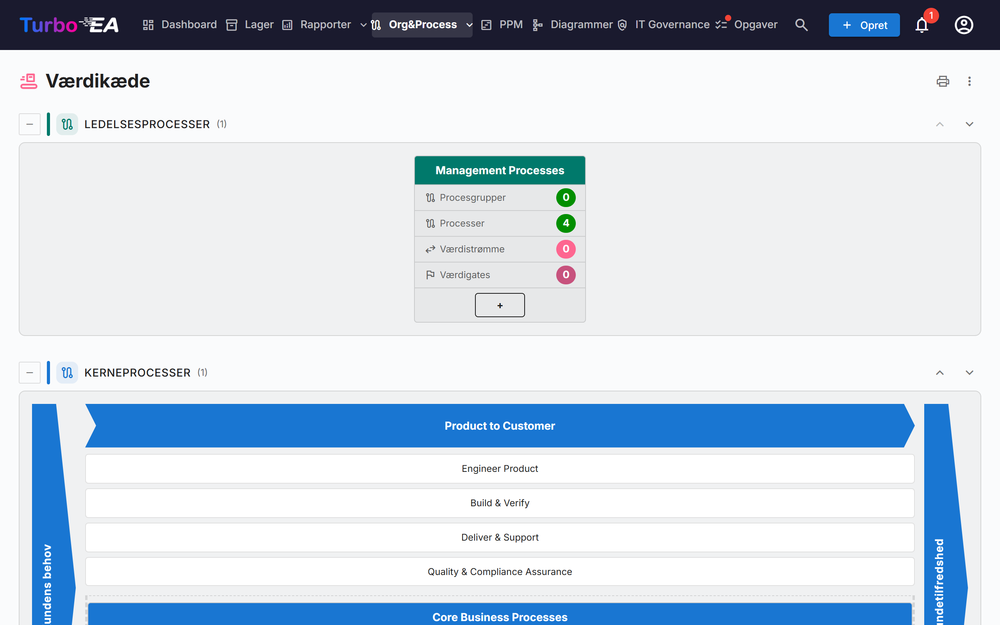
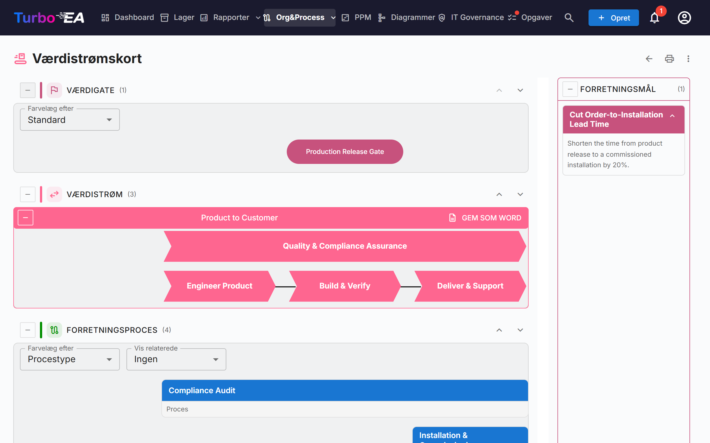

# Værdikæde og værdistrømskort

Siderne **Værdikæde** og **Værdistrømskort** giver et skrivebeskyttet overblik over, hvordan organisationen skaber værdi: hvilke proceskategorier der findes, hvordan kerneværdistrømmene løber fra kundens behov til kundens tilfredshed, og hvilke processer, kompetencer, mål og værdigates der ligger bag hver strøm. Begge sider tegnes ud fra dine eksisterende kort – der indtastes intet på siderne selv.

!!! note
    Siderne hører til [BPM](bpm.md)-området. En administrator kan slå dem fra under **Admin → Indstillinger → BPM-modul** (se [Generelle indstillinger](../admin/settings.md#bpm-modul)); de er desuden skjult, så længe BPM selv er slået fra. For at åbne siderne kræves tilladelsen `bpm.value_chain`.

Åbn dem fra **Org&Process → Værdikæde**.

## Siden Værdikæde

Siden stabler fire bånd, ét for hver **procestype**:

| Bånd | Indhold |
|------|---------|
| **Ledelsesprocesser** | Planlægning, styring og kontrol |
| **Kerneprocesser** | De værdiskabende strømme, tegnet som et "hus" (se nedenfor) |
| **Støtteprocesser** | Aktiviteter, der holder kernen i gang |
| **Processer uden type** | Proceskategorier, hvis *Procestype* endnu ikke er angivet |

Hvert bånd viser antallet af sine felter i parentes. Brug knappen **Skjul** til venstre for båndets titel til at folde det sammen. Pilene op og ned til højre flytter båndet; rækkefølgen deles med [BPM-procesnavigatoren](bpm.md#procesnavigator), og kun brugere, der kan ændre indstillinger (`admin.settings`), ser pilene.

### Felter for proceskategorier

Hver **proceskategori** (et Forretningsproces-kort med undertypen *Proceskategori*) er et felt. Feltets overskrift viser kategoriens navn; under den står fire tællere, beregnet over hele hierarkiet under kategorien:

- **Procesgrupper**
- **Processer**
- **Værdistrømme** – de værdistrømme, som kategoriens processer realiserer
- **Værdigates** – de værdigates, der er knyttet til disse værdistrømme

Klik på feltets overskrift for at **åbne værdistrømskortet** for kategorien.

### Kernehuset

Kernebåndet tegnes som et hus: en afgrænsning **Kundens behov** til venstre, en afgrænsning **Kundetilfredshed** til højre og imellem dem en chevron for hver kerneværdistrøm på øverste niveau. Under hver chevron står dens underordnede værdistrømme som felter, og derefter de processer, der er knyttet direkte til strømmen på øverste niveau, som procesfelter. Klik på en chevron eller et felt for at åbne dets kort.

Huset viser kun værdistrømme på øverste niveau, der er markeret **Er kerne**. Hvis der ingen er, oplyser siden, at ingen kerneværdistrøm er defineret.

## Værdistrømskortet

Åbn kortet fra et kategorifelt. Adressen indeholder kategorien (`/value-chain/value-stream?category=…`), så et kort kan gemmes som bogmærke eller deles. Findes kategorien ikke, eller kan du ikke se den, siger siden det; er den endnu ikke knyttet til nogen værdistrøm, får du et tip i stedet for et tomt kort.

For hver værdistrøm i kategorien tegner kortet op til fire vandrette bånd, oppefra og ned:

| Bånd | Hvad det viser |
|------|----------------|
| **Værdigate** | De værdigates (mål af undertypen *Værdiport*), der er knyttet til strømmen, som piller på linje med de etaper, de hører til |
| **Værdistrøm** | Strømmen som en række chevrons, én pr. etape (dens underordnede værdistrømme), i den rækkefølge, som relationerne *efterfølger* fastlægger. Etaper markeret **Er tværgående** tegnes uden for rækkefølgen |
| **Forretningsproces** | De procesgrupper og processer, der realiserer hver etape, én kolonne pr. etape, lagt i rækker efter **Niveaurækkefølge** |
| **Forretningskompetence** | De forretningskompetencer, der er knyttet til hver etape |

Et panel **Forretningsmål** viser de mål af undertypen *Forretningsmål*, som strømmen er mål for.

### Arbejde med kortet

- **Skjul og omarranger bånd.** Hvert bånd har en skjul-knap og pile op/ned. Rækkefølgen huskes kun i din browser. Båndene Værdigate og Forretningskompetence starter skjult; åbn dem med knappen til venstre for titlen.
- **Farvelæg efter.** Farvelæg værdigates efter **Måltype**, eller processer efter **Procestype**, **Modenhed (CMMI)**, **Automatiseringsniveau** eller **Risikoniveau**. Signaturen forklarer farverne, med "Ikke angivet" for kort uden værdi.
- **Vis relaterede.** Tilføjer under hver proces, som små chips, de **Applikationer**, **Dataobjekter** eller den **Organisation**, som procesforløbet knytter til den. De stammer fra trinnene i processens BPMN-forløb; vælg *Ingen* for at skjule dem.
- **Procesgrupper.** Et gruppefelt kan skjules for at gemme sine underordnede. En proces med et BPMN-forløb viser sit antal trin og en knap **Vis flow**, der viser en forhåndsvisning uden at forlade kortet. Klik på en proces for at åbne dens detaljer ved siden af kortet.
- **Beskrivelser.** Beskrivelsesknappen for en værdistrøm viser eller skjuler dens beskrivelse.

### Eksport

- **Gem som Word** (på hver værdistrøm): en `.docx`-fil med diagrammet på en hvid side, efterfulgt af strømmens forretningsmål og forretningsprocesser.
- **⋮-menuen** og udskriftsknappen øverst på begge sider tilbyder **Udskriv / Gem som PDF**, **Excel** og **PowerPoint**. Regnearkene viser kategorier, værdistrømme, processer, værdigates, kompetencer og mål med oversatte betegnelser.

## Forbered dine data

Siderne læser nedenstående kort. Ingen af dem er nødvendig for at åbne siderne, men hvert af dem udfylder en del af billedet.

| For at få… | Gør dette |
|------------|-----------|
| Et felt pr. proceskategori | Opret Forretningsproces-kort med undertypen **Proceskategori** og angiv deres **Procestype** (Kerne, Støtte, Ledelse) |
| Værdistrømme for en kategori | Opret Forretningskontekst-kort med undertypen **Værdistrøm** og knyt kategoriens processer til dem med relationen **realiserer** (Forretningsproces → Forretningskontekst) |
| Etaper i en strøm | Giv værdistrømmen underordnede værdistrømme (dens hierarki); sortér dem med relationen **efterfølger** og markér **Er tværgående** på dem, der løber på tværs af alle de andre |
| Kernehuset | Markér **Er kerne** på værdistrømmene på øverste niveau; **Sorteringsrækkefølge** ordner etaper uden relationen *efterfølger* |
| Værdigates og mål | Opret Mål-kort med undertypen **Værdiport** eller **Forretningsmål** og knyt dem til værdistrømmen med **er mål for** |
| Processer under en etape | Knyt Forretningsproces-kort til etapen med **realiserer**; **Niveaurækkefølge** fastlægger processens række |
| Kompetencer | Knyt Forretningskompetence-kort til etaperne med **er forbundet med** |

Standardmetamodellen indeholder allerede disse felter, undertyper og relationer; instanser oprettet før denne udgivelse får dem via en automatisk migrering.

## Hvem ser hvad

- Tilladelsen `bpm.value_chain` er skrivebeskyttet. Rollerne Viewer, Member og BPM Admin har den som standard, og administratorer har den implicit. Der findes ingen tilladelse til at redigere kortene: rediger i stedet de underliggende kort.
- Uden tilladelsen `bpm.view` kan siderne åbnes, men processernes trinantal vises som nul, og *Vis relaterede* forbliver tomt.
- Kort, som din rolle skjuler for dig, udelades fra kortene.

!!! tip
    De samme data er tilgængelige for AI-assistenter via MCP-værktøjet `get_value_chain` – se [MCP-integration](../admin/mcp.md).
