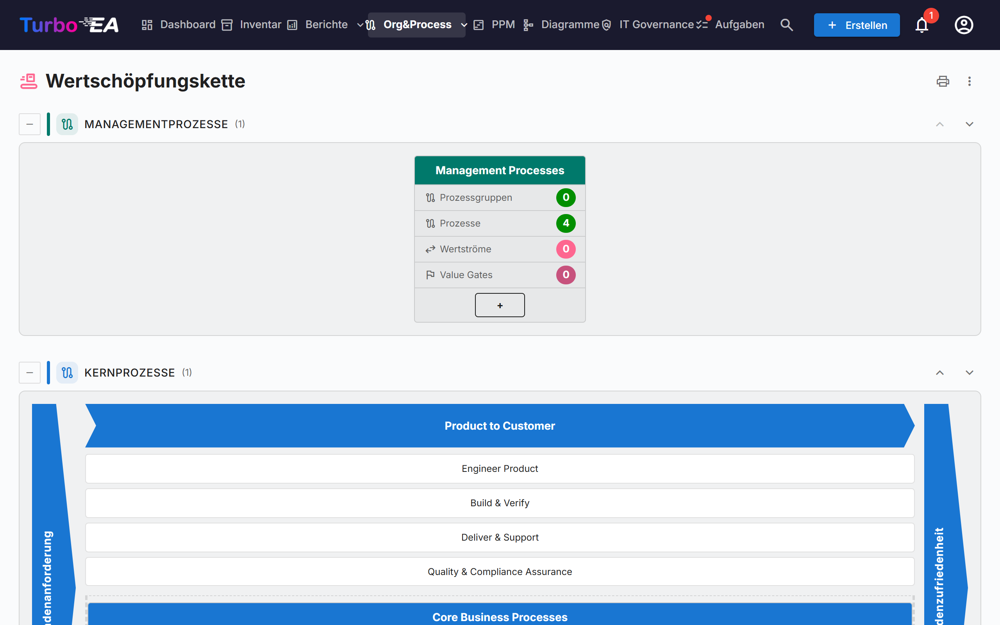
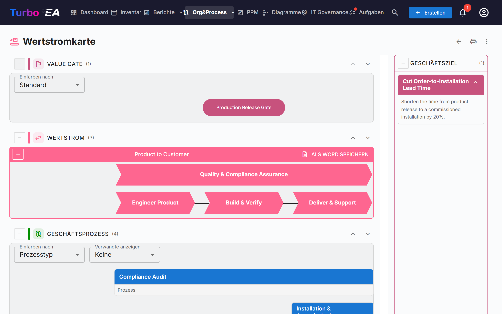

# Wertschöpfungskette und Wertstromkarten

Die Seiten **Wertschöpfungskette** und **Wertstromkarte** zeigen schreibgeschützt, wie die Organisation Wert schafft: welche Prozesskategorien es gibt, wie die Kernwertströme von der Kundenanforderung bis zur Kundenzufriedenheit verlaufen und welche Prozesse, Fähigkeiten, Ziele und Value Gates hinter jedem Wertstrom stehen. Beide Seiten werden aus den vorhandenen Karten gezeichnet – auf den Seiten selbst wird nichts erfasst.

!!! note
    Die Seiten gehören zum Bereich [BPM](bpm.md). Ein Administrator kann sie unter **Admin → Einstellungen → BPM-Modul** ausschalten (siehe [Allgemeine Einstellungen](../admin/settings.md#bpm-modul)); sie sind außerdem ausgeblendet, solange BPM selbst ausgeschaltet ist. Zum Öffnen der Seiten wird die Berechtigung `bpm.value_chain` benötigt.

Sie öffnen die Seiten über **Org&Process → Wertschöpfungskette**.

## Die Seite Wertschöpfungskette

Die Seite stapelt vier Bänder, je eines pro **Prozesstyp**:

| Band | Inhalt |
|------|--------|
| **Managementprozesse** | Planung, Steuerung und Kontrolle |
| **Kernprozesse** | Die wertschöpfenden Wertströme, als „Haus" gezeichnet (siehe unten) |
| **Unterstützungsprozesse** | Tätigkeiten, die den Kern am Laufen halten |
| **Prozesse ohne Typ** | Prozesskategorien, deren *Prozesstyp* noch nicht gesetzt ist |

Jedes Band zeigt die Anzahl seiner Kästen in Klammern. Mit der Schaltfläche **Einklappen** links neben dem Bandtitel klappen Sie ein Band zu. Die Pfeile nach oben und unten rechts verschieben das Band; die Reihenfolge wird mit dem [BPM-Prozessnavigator](bpm.md#prozessnavigator) geteilt, und die Pfeile sehen nur Benutzer, die Einstellungen ändern dürfen (`admin.settings`).

### Kästen der Prozesskategorien

Jede **Prozesskategorie** (eine Geschäftsprozess-Karte mit dem Untertyp *Prozesskategorie*) ist ein Kasten. Sein Kopf zeigt den Namen der Kategorie; darunter stehen vier Zähler, die über die gesamte Hierarchie unterhalb der Kategorie berechnet werden:

- **Prozessgruppen**
- **Prozesse**
- **Wertströme** – die Wertströme, die die Prozesse der Kategorie realisieren
- **Value Gates** – die diesen Wertströmen zugeordneten Value Gates

Ein Klick auf den Kopf des Kastens **öffnet die Wertstromkarte** dieser Kategorie.

### Das Kernhaus

Das Kernband wird als Haus gezeichnet: links eine Begrenzung **Kundenanforderung**, rechts eine Begrenzung **Kundenzufriedenheit** und dazwischen je ein Chevron für jeden Kernwertstrom der obersten Ebene. Unter jedem Chevron stehen seine untergeordneten Wertströme als Kästen; die direkt dem Wertstrom der obersten Ebene zugeordneten Prozesse folgen als Prozesskästen. Ein Klick auf einen Chevron oder einen Kasten öffnet die zugehörige Karte.

Das Haus listet nur die Wertströme der obersten Ebene, die als **Ist Kern** markiert sind. Gibt es keine, weist die Seite darauf hin, dass kein Kernwertstrom definiert ist.

## Die Wertstromkarte

Die Karte öffnen Sie über einen Kategorie-Kasten. Die Adresse enthält die Kategorie (`/value-chain/value-stream?category=…`), sodass sich eine Karte als Lesezeichen speichern oder teilen lässt. Existiert die Kategorie nicht oder können Sie sie nicht sehen, sagt die Seite das; ist die Kategorie noch keinem Wertstrom zugeordnet, erhalten Sie statt einer leeren Karte einen Hinweis.

Für jeden Wertstrom der Kategorie zeichnet die Karte bis zu vier waagerechte Bänder, von oben nach unten:

| Band | Was es zeigt |
|------|--------------|
| **Value Gate** | Die dem Wertstrom zugeordneten Value Gates (Ziele des Untertyps *Value Gate*) als Pillen, ausgerichtet an den Stufen, zu denen sie gehören |
| **Wertstrom** | Der Wertstrom als Reihe von Chevrons, einer pro Stufe (seine untergeordneten Wertströme), in der durch die Beziehungen *folgt auf* festgelegten Reihenfolge. Als **Ist übergreifend** markierte Stufen werden abseits der Abfolge gezeichnet |
| **Geschäftsprozess** | Die Prozessgruppen und Prozesse, die jede Stufe realisieren, eine Spalte pro Stufe, in Zeilen nach **Ebenenreihenfolge** angeordnet |
| **Geschäftsfähigkeit** | Die mit jeder Stufe verknüpften Geschäftsfähigkeiten |

Ein Bereich **Geschäftsziel** listet die Ziele des Untertyps *Geschäftsziel* auf, für die der Wertstrom ein Ziel ist.

### Arbeiten mit der Karte

- **Bänder einklappen und umsortieren.** Jedes Band hat eine Schaltfläche zum Einklappen und Pfeile nach oben/unten. Die Reihenfolge wird nur in Ihrem Browser gespeichert. Die Bänder Value Gate und Geschäftsfähigkeit sind zunächst eingeklappt; Sie öffnen sie mit der Schaltfläche links neben dem Titel.
- **Einfärben nach.** Färben Sie die Value Gates nach **Zieltyp** oder die Prozesse nach **Prozesstyp**, **Reifegrad (CMMI)**, **Automatisierungsgrad** oder **Risikostufe** ein. Die Legende erklärt die Farben, mit „Nicht gesetzt" für Karten ohne Wert.
- **Verwandte anzeigen.** Zeigt die **Anwendungen**, **Datenobjekte** oder die **Organisation**, die der Prozessablauf mit jedem Prozess verknüpft, als kleine Chips unter dem Prozess an. Sie stammen aus den Schritten des BPMN-Ablaufs des Prozesses; mit *Keine* blenden Sie sie aus.
- **Prozessgruppen.** Ein Gruppenkasten lässt sich einklappen, um seine untergeordneten Prozesse auszublenden. Ein Prozess mit BPMN-Ablauf zeigt die Anzahl seiner Schritte und eine Schaltfläche **Ablauf anzeigen**, die eine Vorschau des Ablaufs öffnet, ohne die Karte zu verlassen. Ein Klick auf einen Prozess öffnet seine Details neben der Karte.
- **Beschreibungen.** Der Beschreibungsschalter eines Wertstroms blendet dessen Beschreibung ein oder aus.

### Exportieren

- **Als Word speichern** (bei jedem Wertstrom): eine `.docx`-Datei mit dem Diagramm auf weißer Seite, gefolgt von den Geschäftszielen und den Geschäftsprozessen des Wertstroms.
- Das **⋮-Menü** und die Drucktaste oben auf beiden Seiten bieten **Drucken / Als PDF speichern**, **Excel** und **PowerPoint**. Die Tabellen listen Kategorien, Wertströme, Prozesse, Value Gates, Fähigkeiten und Ziele mit übersetzten Bezeichnungen auf.

## Daten vorbereiten

Die Seiten lesen die folgenden Karten. Keine davon ist zum Öffnen der Seiten nötig, aber jede füllt einen Teil des Bildes.

| Um … zu erhalten | Vorgehen |
|------------------|----------|
| Einen Kasten pro Prozesskategorie | Geschäftsprozess-Karten mit dem Untertyp **Prozesskategorie** anlegen und ihren **Prozesstyp** setzen (Kern, Unterstützung, Management) |
| Wertströme für eine Kategorie | Geschäftskontext-Karten mit dem Untertyp **Wertstrom** anlegen und die Prozesse der Kategorie mit der Beziehung **realisiert** (Geschäftsprozess → Geschäftskontext) mit ihnen verknüpfen |
| Stufen eines Wertstroms | Dem Wertstrom untergeordnete Wertströme geben (seine Hierarchie); mit der Beziehung **folgt auf** ordnen und **Ist übergreifend** bei denen ankreuzen, die quer zu allen anderen laufen |
| Das Kernhaus | **Ist Kern** bei den Wertströmen der obersten Ebene ankreuzen; **Sortierreihenfolge** ordnet Stufen ohne Beziehung *folgt auf* |
| Value Gates und Ziele | Ziel-Karten der Untertypen **Value Gate** oder **Geschäftsziel** anlegen und mit der Beziehung **ist Ziel für** mit dem Wertstrom verknüpfen |
| Prozesse unter einer Stufe | Geschäftsprozess-Karten mit **realisiert** mit der Stufe verknüpfen; **Ebenenreihenfolge** legt die Zeile eines Prozesses fest |
| Fähigkeiten | Geschäftsfähigkeits-Karten mit **ist verknüpft mit** mit den Stufen verknüpfen |

Das Standard-Metamodell enthält diese Felder, Untertypen und Beziehungen bereits; vor diesem Release angelegte Instanzen erhalten sie durch eine automatische Migration.

## Wer was sieht

- Die Berechtigung `bpm.value_chain` ist schreibgeschützt. Die Rollen Viewer, Member und BPM Admin haben sie standardmäßig, Administratoren haben sie implizit. Eine Berechtigung zum Bearbeiten der Karten gibt es nicht: Bearbeiten Sie stattdessen die zugrunde liegenden Karten.
- Ohne die Berechtigung `bpm.view` lassen sich die Seiten öffnen, aber die Schrittzahlen der Prozesse erscheinen als null und *Verwandte anzeigen* bleibt leer.
- Karten, die Ihre Rolle vor Ihnen verbirgt, fehlen in den Karten.

!!! tip
    Dieselben Daten stehen KI-Assistenten über das MCP-Tool `get_value_chain` zur Verfügung – siehe [MCP-Integration](../admin/mcp.md).
