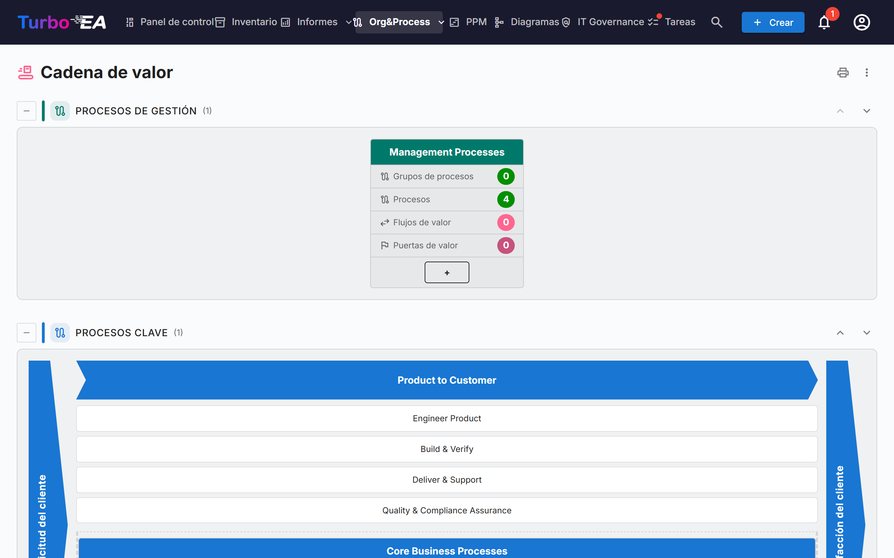
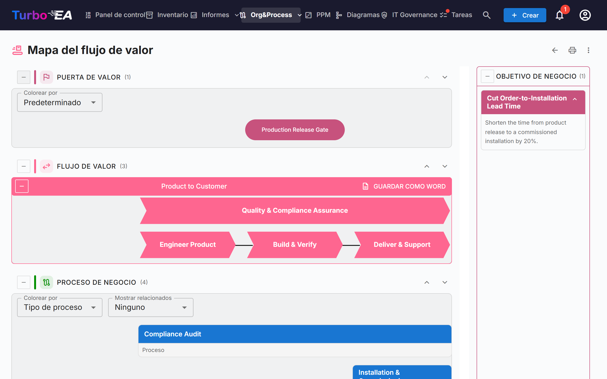

# Cadena de valor y mapas de flujo de valor

Las páginas **Cadena de valor** y **Mapa del flujo de valor** ofrecen una vista de solo lectura de cómo la organización crea valor: qué categorías de procesos existen, cómo discurren los flujos de valor principales desde la solicitud del cliente hasta su satisfacción, y qué procesos, capacidades, objetivos y puertas de valor hay detrás de cada flujo. Ambas páginas se dibujan a partir de sus fichas existentes: no se introduce nada en las propias páginas.

!!! note
    Las páginas forman parte del área de [BPM](bpm.md). Un administrador puede desactivarlas en **Admin → Configuración → Módulo BPM** (véase [Configuración general](../admin/settings.md#modulo-bpm)); además, quedan ocultas mientras el propio BPM esté desactivado. Para abrir las páginas se necesita el permiso `bpm.value_chain`.

Ábralas desde **Org&Process → Cadena de valor**.

## La página Cadena de valor

La página apila cuatro bandas, una por **tipo de proceso**:

| Banda | Contenido |
|-------|-----------|
| **Procesos de gestión** | Planificación, gobierno y control |
| **Procesos clave** | Los flujos que crean valor, dibujados como una «casa» (véase más abajo) |
| **Procesos de soporte** | Actividades que mantienen en marcha el núcleo |
| **Procesos sin tipo** | Categorías de procesos cuyo *Tipo de proceso* aún no está definido |

Cada banda muestra entre paréntesis el número de sus cajas. Use el botón **Contraer** a la izquierda del título de una banda para plegarla. Las flechas arriba y abajo de la derecha mueven la banda; el orden se comparte con el [navegador de procesos BPM](bpm.md#navegador-de-procesos), y solo los usuarios que pueden cambiar la configuración (`admin.settings`) ven las flechas.

### Cajas de categoría de proceso

Cada **categoría de proceso** (una ficha de Proceso de negocio con el subtipo *Categoría de proceso*) es una caja. Su cabecera muestra el nombre de la categoría; debajo hay cuatro contadores, calculados en toda la jerarquía bajo la categoría:

- **Grupos de procesos**
- **Procesos**
- **Flujos de valor**: los flujos de valor que realizan los procesos de la categoría
- **Puertas de valor**: las puertas de valor asociadas a esos flujos de valor

Haga clic en la cabecera de la caja para **abrir el mapa del flujo de valor** de esa categoría.

### La casa de procesos clave

La banda de procesos clave se dibuja como una casa: un extremo **Solicitud del cliente** a la izquierda, un extremo **Satisfacción del cliente** a la derecha y, entre ambos, un chevron por cada flujo de valor clave de primer nivel. Bajo cada chevron aparecen sus flujos de valor hijos como cajas, y después los procesos vinculados directamente al flujo de primer nivel como cajas de proceso. Haga clic en un chevron o en una caja para abrir su ficha.

La casa solo lista los flujos de valor de primer nivel marcados como **Es nuclear**. Si no hay ninguno, la página indica que no se ha definido ningún flujo de valor clave.

## El mapa del flujo de valor

Abra el mapa desde una caja de categoría. La dirección incluye la categoría (`/value-chain/value-stream?category=…`), de modo que un mapa puede guardarse como marcador o compartirse. Si la categoría no existe o no puede verla, la página lo indica; si aún no está vinculada a ningún flujo de valor, aparece una sugerencia en lugar de un mapa vacío.

Para cada flujo de valor de la categoría, el mapa dibuja hasta cuatro bandas horizontales, de arriba abajo:

| Banda | Qué muestra |
|-------|-------------|
| **Puerta de valor** | Las puertas de valor (objetivos del subtipo *Puerta de valor*) asociadas al flujo, como píldoras alineadas con las etapas a las que pertenecen |
| **Flujo de valor** | El flujo como una fila de chevrons, uno por etapa (sus flujos de valor hijos), en el orden fijado por las relaciones *sucede a*. Las etapas marcadas como **Es transversal** se dibujan aparte de la secuencia |
| **Proceso de negocio** | Los grupos de procesos y procesos que realizan cada etapa, una columna por etapa, dispuestos en filas según el **Orden de nivel** |
| **Capacidad de negocio** | Las capacidades de negocio asociadas a cada etapa |

Un panel **Objetivo de negocio** lista los objetivos del subtipo *Objetivo de negocio* de los que el flujo es objetivo.

### Trabajar con el mapa

- **Contraer y reordenar bandas.** Cada banda tiene un botón de contraer y flechas arriba/abajo. El orden solo se recuerda en su navegador. Las bandas Puerta de valor y Capacidad de negocio aparecen contraídas al principio; expándalas con el botón situado a la izquierda de su título.
- **Colorear por.** Coloree las puertas de valor por **Tipo de objetivo**, o los procesos por **Tipo de proceso**, **Madurez (CMMI)**, **Nivel de automatización** o **Nivel de riesgo**. La leyenda explica los colores, con «Sin definir» para las fichas sin valor.
- **Mostrar relacionados.** Añade bajo cada proceso, como pequeñas etiquetas, las **Aplicaciones**, **Objetos de datos** u **Organización** que el flujo del proceso le vincula. Provienen de los pasos del flujo BPMN del proceso; elija *Ninguno* para ocultarlos.
- **Grupos de procesos.** Una caja de grupo puede contraerse para ocultar sus hijos. Un proceso con flujo BPMN muestra su número de pasos y un botón **Ver flujo** que muestra una vista previa sin salir del mapa. Haga clic en un proceso para abrir sus detalles junto al mapa.
- **Descripciones.** El conmutador de descripción de un flujo de valor muestra u oculta su descripción.

### Exportar

- **Guardar como Word** (en cada flujo de valor): un `.docx` con el diagrama en una página en blanco, seguido de los objetivos de negocio y los procesos de negocio del flujo.
- El **menú ⋮** y el botón de impresión en la parte superior de ambas páginas ofrecen **Imprimir / Guardar como PDF**, **Excel** y **PowerPoint**. Las hojas listan categorías, flujos de valor, procesos, puertas, capacidades y objetivos con etiquetas traducidas.

## Preparar sus datos

Las páginas leen las fichas siguientes. Ninguna es necesaria para abrir las páginas, pero cada una completa una parte de la imagen.

| Para obtener… | Haga esto |
|---------------|-----------|
| Una caja por categoría de proceso | Cree fichas de Proceso de negocio del subtipo **Categoría de proceso** y defina su **Tipo de proceso** (Clave, Soporte, Gestión) |
| Flujos de valor para una categoría | Cree fichas de Contexto de negocio del subtipo **Cadena de valor** y vincule a ellas los procesos de la categoría con la relación **realiza** (Proceso de negocio → Contexto de negocio) |
| Las etapas de un flujo | Dé al flujo de valor flujos de valor hijos (su jerarquía); ordénelos con la relación **sucede a** y marque **Es transversal** en los que atraviesan a todos los demás |
| La casa de procesos clave | Marque **Es nuclear** en los flujos de valor de primer nivel; **Orden de clasificación** ordena las etapas sin relación *sucede a* |
| Puertas de valor y objetivos | Cree fichas de Objetivo de los subtipos **Hito de valor** u **Objetivo de negocio** y vincúlelas al flujo con **es objetivo de** |
| Procesos bajo una etapa | Vincule fichas de Proceso de negocio a la etapa con **realiza**; **Orden de nivel** fija la fila de un proceso |
| Capacidades | Vincule fichas de Capacidad de negocio a las etapas con **está asociado con** |

El metamodelo por defecto ya contiene estos campos, subtipos y relaciones; las instancias creadas antes de esta versión los reciben mediante una migración automática.

## Quién ve qué

- El permiso `bpm.value_chain` es de solo lectura. Los roles Viewer, Member y BPM Admin lo tienen por defecto y los administradores lo tienen de forma implícita. No existe un permiso para editar los mapas: edite las fichas subyacentes.
- Sin el permiso `bpm.view`, las páginas se abren, pero el número de pasos de los procesos aparece como cero y *Mostrar relacionados* queda vacío.
- Las fichas que su rol le oculta no aparecen en los mapas.

!!! tip
    Los mismos datos están disponibles para los asistentes de IA mediante la herramienta MCP `get_value_chain`; véase [Integración MCP](../admin/mcp.md).
