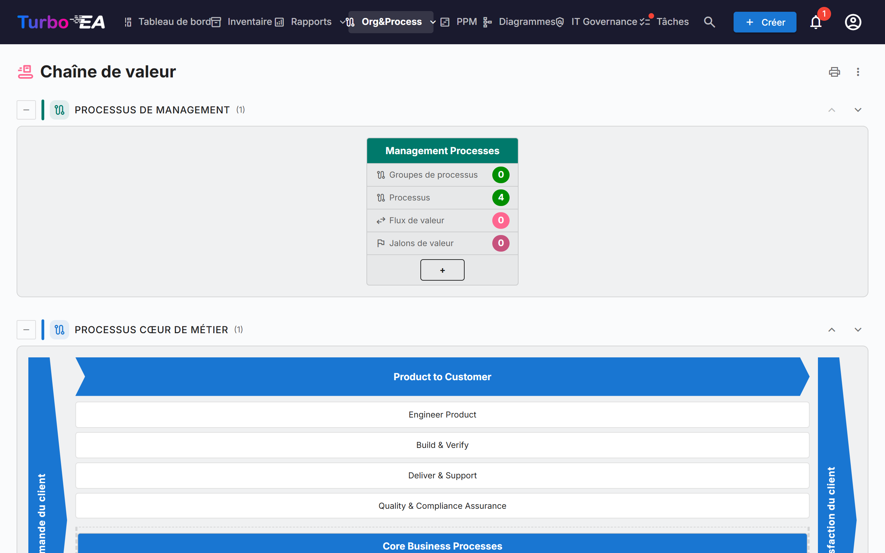
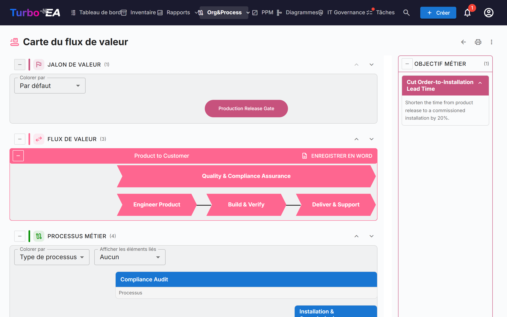

# Chaîne de valeur et cartes de flux de valeur

Les pages **Chaîne de valeur** et **Carte du flux de valeur** donnent une vue en lecture seule de la manière dont l'organisation crée de la valeur : quelles catégories de processus existent, comment les flux de valeur cœur de métier vont de la demande du client à sa satisfaction, et quels processus, capacités, objectifs et jalons de valeur se trouvent derrière chaque flux. Les deux pages sont dessinées à partir de vos fiches existantes : rien n'est saisi sur les pages elles-mêmes.

!!! note
    Les pages font partie du domaine [BPM](bpm.md). Un administrateur peut les désactiver dans **Admin → Paramètres → Module BPM** (voir [Paramètres généraux](../admin/settings.md#module-bpm)) ; elles sont aussi masquées tant que le BPM lui-même est désactivé. L'ouverture des pages requiert la permission `bpm.value_chain`.

Ouvrez-les depuis **Org&Process → Chaîne de valeur**.

## La page Chaîne de valeur

La page empile quatre bandes, une par **type de processus** :

| Bande | Contenu |
|-------|---------|
| **Processus de management** | Planification, pilotage et contrôle |
| **Processus cœur de métier** | Les flux créateurs de valeur, dessinés comme une « maison » (voir ci-dessous) |
| **Processus support** | Les activités qui font tourner le cœur de métier |
| **Processus sans type** | Les catégories de processus dont le *Type de processus* n'est pas encore renseigné |

Chaque bande indique entre parenthèses le nombre de ses cases. Le bouton **Réduire** à gauche du titre d'une bande la replie. Les flèches haut et bas à droite déplacent la bande ; l'ordre est partagé avec le [navigateur de processus BPM](bpm.md#navigateur-de-processus), et seuls les utilisateurs autorisés à modifier les paramètres (`admin.settings`) voient les flèches.

### Cases des catégories de processus

Chaque **catégorie de processus** (une fiche Processus métier de sous-type *Catégorie de processus*) est une case. Son en-tête affiche le nom de la catégorie ; en dessous figurent quatre compteurs, calculés sur toute la hiérarchie sous la catégorie :

- **Groupes de processus**
- **Processus**
- **Flux de valeur** : les flux de valeur que réalisent les processus de la catégorie
- **Jalons de valeur** : les jalons de valeur rattachés à ces flux de valeur

Cliquez sur l'en-tête de la case pour **ouvrir la carte du flux de valeur** de cette catégorie.

### La maison cœur de métier

La bande cœur de métier est dessinée comme une maison : une extrémité **Demande du client** à gauche, une extrémité **Satisfaction du client** à droite et, entre les deux, un chevron pour chaque flux de valeur cœur de métier de premier niveau. Sous chaque chevron figurent ses flux de valeur enfants sous forme de cases, puis les processus rattachés directement au flux de premier niveau sous forme de cases de processus. Cliquez sur un chevron ou une case pour ouvrir sa fiche.

La maison ne liste que les flux de valeur de premier niveau marqués **Est cœur de métier**. S'il n'y en a aucun, la page indique qu'aucun flux de valeur cœur de métier n'est défini.

## La carte du flux de valeur

Ouvrez la carte depuis une case de catégorie. L'adresse contient la catégorie (`/value-chain/value-stream?category=…`) : une carte peut donc être mise en favori ou partagée. Si la catégorie n'existe pas ou si vous ne pouvez pas la voir, la page le dit ; si elle n'est encore reliée à aucun flux de valeur, vous obtenez une indication plutôt qu'une carte vide.

Pour chaque flux de valeur de la catégorie, la carte dessine jusqu'à quatre bandes horizontales, de haut en bas :

| Bande | Ce qu'elle montre |
|-------|-------------------|
| **Jalon de valeur** | Les jalons de valeur (objectifs de sous-type *Jalon de valeur*) rattachés au flux, sous forme de pastilles alignées sur les étapes auxquelles ils appartiennent |
| **Flux de valeur** | Le flux sous forme d'une rangée de chevrons, un par étape (ses flux de valeur enfants), dans l'ordre défini par les relations *succède à*. Les étapes marquées **Est transversal** sont dessinées à l'écart de la séquence |
| **Processus métier** | Les groupes de processus et les processus qui réalisent chaque étape, une colonne par étape, disposés en lignes selon l'**Ordre de niveau** |
| **Capacité métier** | Les capacités métier associées à chaque étape |

Un panneau **Objectif métier** liste les objectifs de sous-type *Objectif métier* dont le flux est un objectif.

### Travailler avec la carte

- **Réduire et réordonner les bandes.** Chaque bande a un bouton de réduction et des flèches haut/bas. L'ordre n'est mémorisé que dans votre navigateur. Les bandes Jalon de valeur et Capacité métier sont repliées au départ ; dépliez-les avec le bouton à gauche de leur titre.
- **Colorer par.** Colorez les jalons de valeur par **Type d'objectif**, ou les processus par **Type de processus**, **Maturité (CMMI)**, **Niveau d'automatisation** ou **Niveau de risque**. La légende explique les couleurs, avec « Non défini » pour les fiches sans valeur.
- **Afficher les éléments liés.** Ajoute sous chaque processus, sous forme de petites pastilles, les **Applications**, **Objets de données** ou l'**Organisation** que le flux du processus lui relie. Ils proviennent des étapes du flux BPMN du processus ; choisissez *Aucun* pour les masquer.
- **Groupes de processus.** Une case de groupe peut être repliée pour masquer ses enfants. Un processus doté d'un flux BPMN affiche son nombre d'étapes et un bouton **Voir le flux** qui en donne un aperçu sans quitter la carte. Cliquez sur un processus pour ouvrir ses détails à côté de la carte.
- **Descriptions.** Le bouton de description d'un flux de valeur affiche ou masque sa description.

### Exporter

- **Enregistrer en Word** (sur chaque flux de valeur) : un fichier `.docx` avec le diagramme sur une page blanche, suivi des objectifs métier et des processus métier du flux.
- Le **menu ⋮** et le bouton d'impression en haut des deux pages proposent **Imprimer / Enregistrer en PDF**, **Excel** et **PowerPoint**. Les tableaux listent les catégories, flux de valeur, processus, jalons, capacités et objectifs avec des libellés traduits.

## Préparer vos données

Les pages lisent les fiches ci-dessous. Aucune n'est nécessaire pour ouvrir les pages, mais chacune complète une partie de l'image.

| Pour obtenir… | Faites ceci |
|---------------|-------------|
| Une case par catégorie de processus | Créez des fiches Processus métier de sous-type **Catégorie de processus** et renseignez leur **Type de processus** (Cœur de métier, Support, Management) |
| Des flux de valeur pour une catégorie | Créez des fiches Contexte métier de sous-type **Chaîne de valeur** et reliez-y les processus de la catégorie avec la relation **réalise** (Processus métier → Contexte métier) |
| Les étapes d'un flux | Donnez au flux de valeur des flux enfants (sa hiérarchie) ; ordonnez-les avec la relation **succède à** et cochez **Est transversal** sur ceux qui traversent tous les autres |
| La maison cœur de métier | Cochez **Est cœur de métier** sur les flux de premier niveau ; **Ordre de tri** ordonne les étapes sans relation *succède à* |
| Jalons de valeur et objectifs | Créez des fiches Objectif de sous-type **Jalon de valeur** ou **Objectif métier** et reliez-les au flux avec **est un objectif pour** |
| Les processus sous une étape | Reliez des fiches Processus métier à l'étape avec **réalise** ; **Ordre de niveau** fixe la ligne d'un processus |
| Les capacités | Reliez des fiches Capacité métier aux étapes avec **est associé à** |

Le métamodèle par défaut contient déjà ces champs, sous-types et relations ; les instances créées avant cette version les reçoivent par une migration automatique.

## Qui voit quoi

- La permission `bpm.value_chain` est en lecture seule. Les rôles Viewer, Member et BPM Admin l'ont par défaut et les administrateurs l'ont implicitement. Il n'existe pas de permission pour modifier les cartes : modifiez les fiches sous-jacentes.
- Sans la permission `bpm.view`, les pages s'ouvrent, mais le nombre d'étapes des processus s'affiche à zéro et *Afficher les éléments liés* reste vide.
- Les fiches que votre rôle vous masque sont absentes des cartes.

!!! tip
    Les mêmes données sont disponibles pour les assistants IA via l'outil MCP `get_value_chain` — voir [Intégration MCP](../admin/mcp.md).
