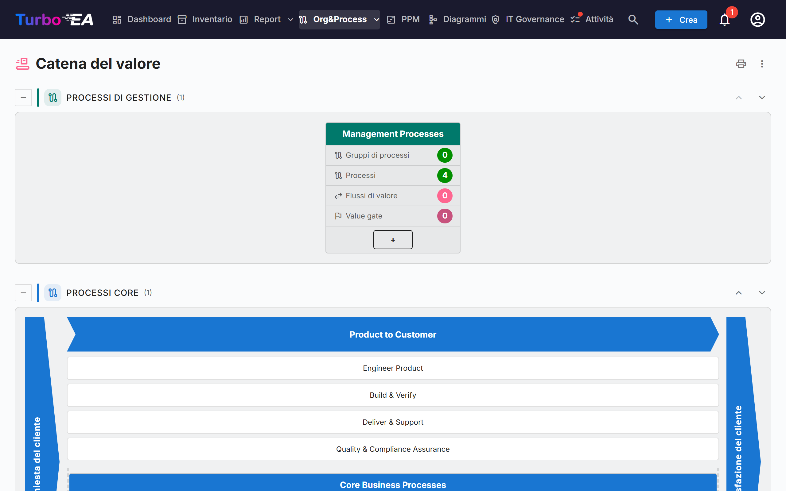
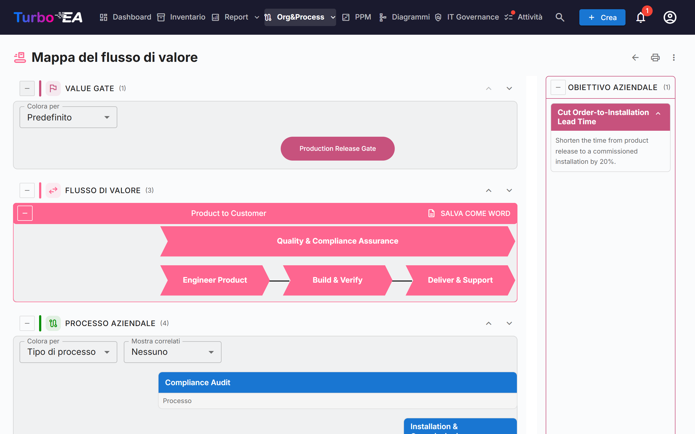

# Catena del valore e mappe dei flussi di valore

Le pagine **Catena del valore** e **Mappa del flusso di valore** offrono una vista in sola lettura di come l'organizzazione crea valore: quali categorie di processi esistono, come i flussi di valore core vanno dalla richiesta del cliente alla sua soddisfazione e quali processi, capacità, obiettivi e value gate stanno dietro ciascun flusso. Entrambe le pagine sono disegnate a partire dalle card esistenti: sulle pagine stesse non si inserisce nulla.

!!! note
    Le pagine fanno parte dell'area [BPM](bpm.md). Un amministratore può disattivarle in **Admin → Impostazioni → Modulo BPM** (vedi [Impostazioni generali](../admin/settings.md#modulo-bpm)); inoltre restano nascoste finché il BPM stesso è disattivato. Per aprire le pagine serve il permesso `bpm.value_chain`.

Si aprono da **Org&Process → Catena del valore**.

## La pagina Catena del valore

La pagina impila quattro fasce, una per **tipo di processo**:

| Fascia | Contenuto |
|--------|-----------|
| **Processi di gestione** | Pianificazione, governo e controllo |
| **Processi core** | I flussi che creano valore, disegnati come una «casa» (vedi sotto) |
| **Processi di supporto** | Attività che mantengono in funzione il core |
| **Processi senza tipo** | Categorie di processi il cui *Tipo di processo* non è ancora impostato |

Ogni fascia mostra tra parentesi il numero dei suoi riquadri. Il pulsante **Comprimi** a sinistra del titolo di una fascia la ripiega. Le frecce su e giù a destra spostano la fascia; l'ordine è condiviso con il [navigatore dei processi BPM](bpm.md#navigatore-dei-processi) e solo gli utenti che possono modificare le impostazioni (`admin.settings`) vedono le frecce.

### Riquadri delle categorie di processi

Ogni **categoria di processi** (una card Processo aziendale con il sottotipo *Categoria di processo*) è un riquadro. La sua intestazione mostra il nome della categoria; sotto ci sono quattro contatori, calcolati su tutta la gerarchia sotto la categoria:

- **Gruppi di processi**
- **Processi**
- **Flussi di valore**: i flussi di valore che i processi della categoria realizzano
- **Value gate**: i value gate collegati a quei flussi di valore

Facendo clic sull'intestazione del riquadro si **apre la mappa del flusso di valore** di quella categoria.

### La casa del core

La fascia core è disegnata come una casa: un'estremità **Richiesta del cliente** a sinistra, un'estremità **Soddisfazione del cliente** a destra e, in mezzo, un chevron per ogni flusso di valore core di primo livello. Sotto ogni chevron compaiono i suoi flussi di valore figli come riquadri e, di seguito, i processi collegati direttamente al flusso di primo livello come riquadri di processo. Un clic su un chevron o su un riquadro apre la relativa card.

La casa elenca solo i flussi di valore di primo livello contrassegnati come **È core**. Se non ce n'è nessuno, la pagina segnala che non è definito alcun flusso di valore core.

## La mappa del flusso di valore

Si apre la mappa da un riquadro di categoria. L'indirizzo contiene la categoria (`/value-chain/value-stream?category=…`), quindi una mappa può essere salvata tra i preferiti o condivisa. Se la categoria non esiste o non è visibile, la pagina lo dice; se non è ancora collegata ad alcun flusso di valore, compare un suggerimento invece di una mappa vuota.

Per ogni flusso di valore della categoria la mappa disegna fino a quattro fasce orizzontali, dall'alto in basso:

| Fascia | Cosa mostra |
|--------|-------------|
| **Value gate** | I value gate (obiettivi del sottotipo *Value Gate*) collegati al flusso, come pillole allineate alle fasi a cui appartengono |
| **Flusso di valore** | Il flusso come una fila di chevron, uno per fase (i suoi flussi di valore figli), nell'ordine stabilito dalle relazioni *succede a*. Le fasi contrassegnate come **È trasversale** sono disegnate a parte rispetto alla sequenza |
| **Processo aziendale** | I gruppi di processi e i processi che realizzano ciascuna fase, una colonna per fase, disposti in righe secondo l'**Ordine di livello** |
| **Capacità aziendale** | Le capacità aziendali associate a ciascuna fase |

Un pannello **Obiettivo aziendale** elenca gli obiettivi del sottotipo *Obiettivo di business* di cui il flusso è obiettivo.

### Lavorare con la mappa

- **Comprimere e riordinare le fasce.** Ogni fascia ha un pulsante per comprimerla e frecce su/giù. L'ordine viene ricordato solo nel browser. Le fasce Value gate e Capacità aziendale partono compresse; espandile con il pulsante a sinistra del titolo.
- **Colora per.** Colora i value gate per **Tipo di obiettivo**, oppure i processi per **Tipo di processo**, **Maturità (CMMI)**, **Livello di automazione** o **Livello di rischio**. La legenda spiega i colori, con «Non impostato» per le card senza valore.
- **Mostra correlati.** Aggiunge sotto ogni processo, come piccoli chip, le **Applicazioni**, gli **Oggetti dati** o l'**Organizzazione** che il flusso del processo gli collega. Provengono dai passi del flusso BPMN del processo; scegli *Nessuno* per nasconderli.
- **Gruppi di processi.** Un riquadro di gruppo può essere compresso per nascondere i suoi figli. Un processo con un flusso BPMN mostra il numero dei suoi passi e un pulsante **Visualizza flusso** che ne mostra un'anteprima senza lasciare la mappa. Un clic su un processo apre i suoi dettagli accanto alla mappa.
- **Descrizioni.** L'interruttore della descrizione di un flusso di valore mostra o nasconde la sua descrizione.

### Esportare

- **Salva come Word** (su ogni flusso di valore): un file `.docx` con il diagramma su una pagina bianca, seguito dagli obiettivi aziendali e dai processi aziendali del flusso.
- Il **menu ⋮** e il pulsante di stampa in alto in entrambe le pagine offrono **Stampa / Salva come PDF**, **Excel** e **PowerPoint**. I fogli elencano categorie, flussi di valore, processi, value gate, capacità e obiettivi con etichette tradotte.

## Preparare i dati

Le pagine leggono le card seguenti. Nessuna è necessaria per aprire le pagine, ma ognuna completa una parte del quadro.

| Per ottenere… | Procedi così |
|---------------|--------------|
| Un riquadro per categoria di processi | Crea card Processo aziendale con il sottotipo **Categoria di processo** e imposta il loro **Tipo di processo** (Core, Supporto, Gestione) |
| Flussi di valore per una categoria | Crea card Contesto aziendale con il sottotipo **Flusso di valore** e collega ad esse i processi della categoria con la relazione **realizza** (Processo aziendale → Contesto aziendale) |
| Le fasi di un flusso | Assegna al flusso di valore dei flussi figli (la sua gerarchia); ordinali con la relazione **succede a** e spunta **È trasversale** su quelli che attraversano tutti gli altri |
| La casa del core | Spunta **È core** sui flussi di valore di primo livello; **Ordine di visualizzazione** ordina le fasi senza relazione *succede a* |
| Value gate e obiettivi | Crea card Obiettivo con il sottotipo **Value Gate** oppure **Obiettivo di business** e collegale al flusso con **è obiettivo per** |
| I processi sotto una fase | Collega card Processo aziendale alla fase con **realizza**; **Ordine di livello** stabilisce la riga di un processo |
| Le capacità | Collega card Capacità aziendale alle fasi con **è associato a** |

Il metamodello predefinito contiene già questi campi, sottotipi e relazioni; le istanze create prima di questa versione li ricevono con una migrazione automatica.

## Chi vede cosa

- Il permesso `bpm.value_chain` è in sola lettura. I ruoli Viewer, Member e BPM Admin lo hanno per impostazione predefinita e gli amministratori lo hanno implicitamente. Non esiste un permesso per modificare le mappe: modifica invece le card sottostanti.
- Senza il permesso `bpm.view` le pagine si aprono, ma il numero di passi dei processi appare a zero e *Mostra correlati* resta vuoto.
- Le card che il tuo ruolo ti nasconde non compaiono nelle mappe.

!!! tip
    Gli stessi dati sono disponibili agli assistenti IA tramite lo strumento MCP `get_value_chain`: vedi [Integrazione MCP](../admin/mcp.md).
