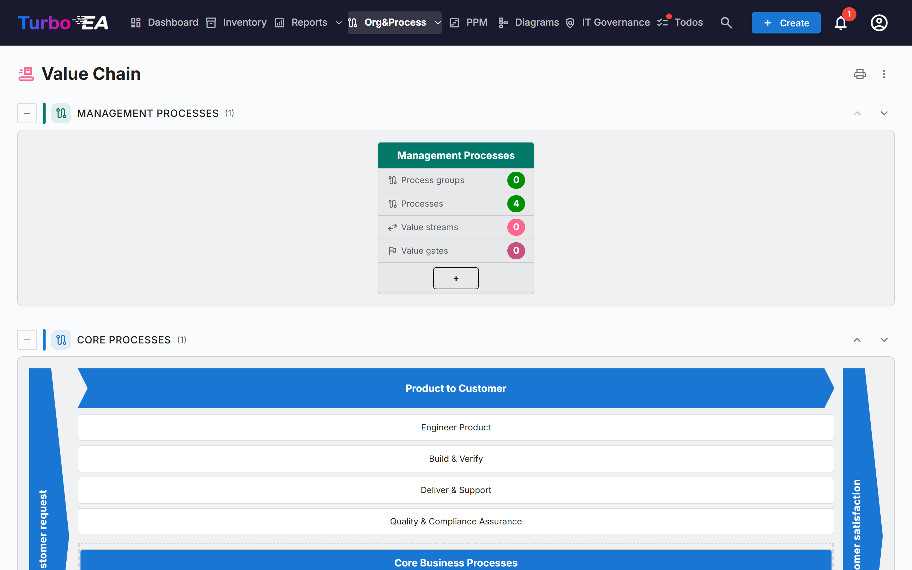
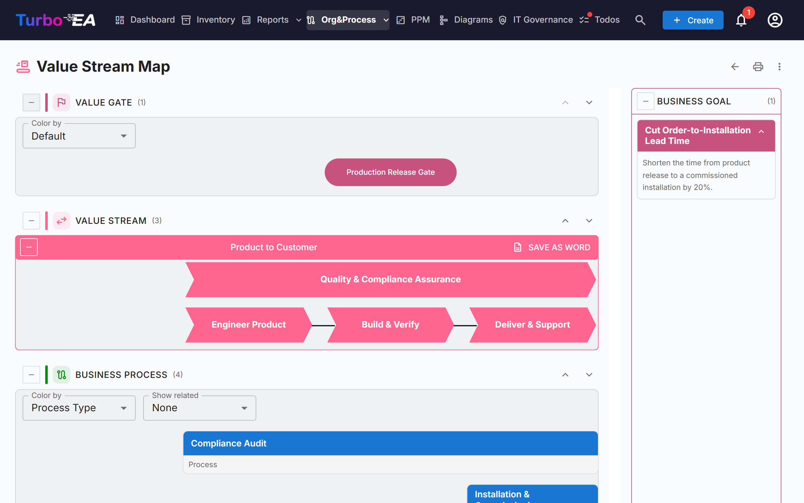

# Value Chain and Value Stream Maps

The **Value Chain** page and the **Value Stream Map** page give a read-only picture of how the organisation creates value: which process categories exist, how the core value streams run from the customer request to the customer's satisfaction, and which processes, capabilities, goals and gates sit behind each stream. Both pages are drawn from your existing cards — nothing is entered on the pages themselves.

!!! note
    The pages are part of the [BPM](bpm.md) area. An administrator can switch them off in **Admin → Settings → BPM Module** (see [General Settings](../admin/settings.md#bpm-module)); they are also hidden whenever BPM itself is off. Opening the pages needs the permission **View the value chain and value stream maps** (`bpm.value_chain`).

Open them from **Org&Process → Value Chain**.

## The Value Chain page

The page stacks four bands, one per **process type**:

| Band | Contents |
|------|----------|
| **Management processes** | Planning, governance and control |
| **Core processes** | The value-creating streams, drawn as a "house" (see below) |
| **Support processes** | Activities that keep the core running |
| **Processes without a type** | Process categories whose *Process Type* has not been set yet |

Each band shows its number of boxes in brackets. Use the **collapse** button at the left of a band title to fold it. The up and down arrows on the right move the band; the order is shared with the [BPM process navigator](bpm.md#process-navigator), and only users who can change settings (`admin.settings`) see the arrows.

### Process category boxes

Every **process category** (a Business Process card with the *Process category* subtype) is a box. Its header shows the category name; below it are four counts, calculated through the whole hierarchy under the category:

- **Process groups**
- **Processes**
- **Value streams** — the value streams that the category's processes realise
- **Value gates** — the value gates attached to those value streams

Click the box header to **open the value stream map** of that category.

### The core house

The core band is drawn as a house: a **Customer request** bookend on the left, a **Customer satisfaction** bookend on the right, and between them one chevron for each top-level core value stream. Under each chevron sit its child value streams as boxes, and the processes linked directly to the top-level stream follow as process boxes. Click a chevron or a box to open its card.

The house lists only the top-level value streams that are flagged **Is Core**. If there are none, the page says that no core value stream is defined.

## The Value Stream Map

Open the map from a category box. The address carries the category (`/value-chain/value-stream?category=…`), so a map can be bookmarked or shared. If the category does not exist, or you cannot see it, the page says so; if the category is not linked to any value stream yet, you get a hint instead of an empty map.

For each value stream of the category the map draws up to four horizontal bands, from top to bottom:

| Band | What it shows |
|------|---------------|
| **Value gate** | The value gates (objectives of the *Value gate* subtype) attached to the stream, as pills lined up with the stages they belong to |
| **Value stream** | The stream as a row of chevrons, one per stage — its child value streams — in the order set by the *succeeds* relations. Stages marked **Is Cross-Cutting** are drawn apart from the sequence |
| **Business process** | The process groups and processes that realise each stage, one column per stage, laid out in rows by **Level Order** |
| **Business capability** | The business capabilities associated with each stage |

A **Business goal** panel lists the objectives of the *Business goal* subtype that the stream is a goal for.

### Working with the map

- **Collapse and reorder bands.** Each band has a collapse button and up/down arrows. The order is remembered in your browser only. The value gate and business capability bands start folded; expand them with the button at the left of their title.
- **Color by.** Colour the value gates by **Objective type**, or the processes by **Process type**, **Maturity (CMMI)**, **Automation level** or **Risk level**. The legend explains the colours, with "Not set" for cards that have no value.
- **Show related.** Add the **Applications**, **Data objects** or **Organization** that the process flow links to each process as small chips under it. These come from the steps of the process's BPMN flow; choose *None* to hide them.
- **Process groups.** A group box can be collapsed to hide its children. A process with a BPMN flow shows its number of steps and a **View flow** button that previews the flow without leaving the map. Click a process to open its details beside the map.
- **Descriptions.** The description toggle of a stream shows or hides its description.

### Exporting

- **Save as Word** (on each value stream): a `.docx` with the diagram on a white page, followed by the stream's business goals and its business processes.
- The **⋮ menu** and the print button at the top of both pages offer **Print / Save as PDF**, **Excel** and **PowerPoint**. The spreadsheets list the categories, value streams, processes, gates, capabilities and goals, using translated labels.

## Preparing your data

The pages read these cards. None of them is needed to open the pages, but each one fills a part of the picture.

| To get… | Do this |
|---------|---------|
| A box per process category | Create Business Process cards of subtype **Process category** and set their **Process Type** (Core, Support, Management) |
| Value streams for a category | Create Business Context cards of subtype **Value stream** and link the category's processes to them with the **realizes** relation (Business Process → Business Context) |
| Stages of a stream | Give the value stream child value streams (its hierarchy); order them with the **succeeds** relation and tick **Is Cross-Cutting** on those that run across all the others |
| The core house | Tick **Is Core** on the top-level value streams; **Sort Order** orders stages that have no *succeeds* relation |
| Value gates and goals | Create Objective cards of subtype **Value gate** or **Business goal** and link them to the value stream with **is goal for** |
| Processes under a stage | Link Business Process cards to the stage with **realizes**; **Level Order** sets the row of a process |
| Capabilities | Link Business Capability cards to the stages with **is associated with** |

The default metamodel already contains these fields, subtypes and relations; instances created before this release receive them through an automatic migration.

## Who sees what

- The permission **View the value chain and value stream maps** (`bpm.value_chain`) is read-only. The Viewer, Member and BPM Admin roles have it by default and administrators have it implicitly. There is no permission to edit the maps: edit the underlying cards instead.
- Without the `bpm.view` permission the pages open, but process step counts show as zero and *Show related* stays empty.
- Cards that your role hides from you are left out of the maps.

!!! tip
    The same data is available to AI assistants through the MCP tool `get_value_chain` — see [MCP Integration](../admin/mcp.md).
