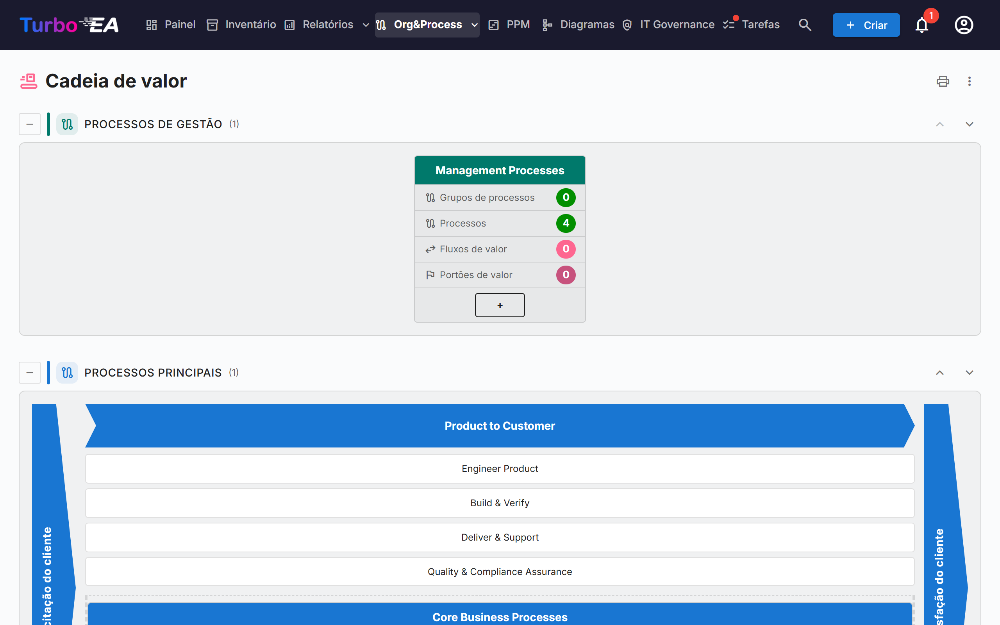
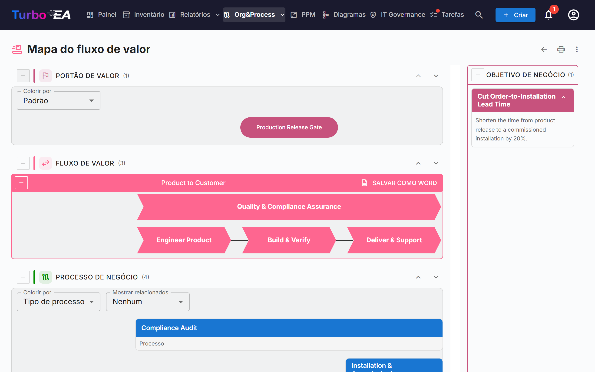

# Cadeia de valor e mapas de fluxo de valor

As páginas **Cadeia de valor** e **Mapa do fluxo de valor** oferecem uma visão somente leitura de como a organização cria valor: quais categorias de processos existem, como os fluxos de valor principais vão da solicitação do cliente até a satisfação dele e quais processos, capacidades, objetivos e portões de valor estão por trás de cada fluxo. As duas páginas são desenhadas a partir dos seus cards existentes: nada é digitado nas próprias páginas.

!!! note
    As páginas fazem parte da área de [BPM](bpm.md). Um administrador pode desativá-las em **Admin → Configurações → Módulo BPM** (veja [Configurações gerais](../admin/settings.md#modulo-bpm)); elas também ficam ocultas enquanto o próprio BPM estiver desativado. Para abrir as páginas é preciso ter a permissão `bpm.value_chain`.

Abra-as em **Org&Process → Cadeia de valor**.

## A página Cadeia de valor

A página empilha quatro faixas, uma por **tipo de processo**:

| Faixa | Conteúdo |
|-------|----------|
| **Processos de gestão** | Planejamento, governança e controle |
| **Processos principais** | Os fluxos que criam valor, desenhados como uma "casa" (veja abaixo) |
| **Processos de suporte** | Atividades que mantêm o núcleo em funcionamento |
| **Processos sem tipo** | Categorias de processos cujo *Tipo de processo* ainda não foi definido |

Cada faixa mostra entre parênteses o número de suas caixas. Use o botão **Recolher** à esquerda do título de uma faixa para dobrá-la. As setas para cima e para baixo, à direita, movem a faixa; a ordem é compartilhada com o [navegador de processos do BPM](bpm.md#navegador-de-processos), e somente quem pode alterar as configurações (`admin.settings`) vê as setas.

### Caixas das categorias de processos

Cada **categoria de processos** (um card de Processo de negócio com o subtipo *Categoria de processo*) é uma caixa. O cabeçalho mostra o nome da categoria; abaixo há quatro contadores, calculados em toda a hierarquia sob a categoria:

- **Grupos de processos**
- **Processos**
- **Fluxos de valor**: os fluxos de valor que os processos da categoria realizam
- **Portões de valor**: os portões de valor ligados a esses fluxos de valor

Clique no cabeçalho da caixa para **abrir o mapa do fluxo de valor** dessa categoria.

### A casa dos processos principais

A faixa principal é desenhada como uma casa: uma extremidade **Solicitação do cliente** à esquerda, uma extremidade **Satisfação do cliente** à direita e, entre elas, um chevron para cada fluxo de valor principal de primeiro nível. Sob cada chevron aparecem seus fluxos de valor filhos como caixas e, em seguida, os processos ligados diretamente ao fluxo de primeiro nível como caixas de processo. Clique em um chevron ou em uma caixa para abrir o card correspondente.

A casa lista apenas os fluxos de valor de primeiro nível marcados como **É central**. Se não houver nenhum, a página informa que nenhum fluxo de valor principal está definido.

## O mapa do fluxo de valor

Abra o mapa a partir de uma caixa de categoria. O endereço contém a categoria (`/value-chain/value-stream?category=…`), de modo que um mapa pode ser salvo como favorito ou compartilhado. Se a categoria não existir ou você não puder vê-la, a página avisa; se ela ainda não estiver ligada a nenhum fluxo de valor, aparece uma dica em vez de um mapa vazio.

Para cada fluxo de valor da categoria, o mapa desenha até quatro faixas horizontais, de cima para baixo:

| Faixa | O que mostra |
|-------|--------------|
| **Portão de valor** | Os portões de valor (objetivos do subtipo *Marco de valor*) ligados ao fluxo, como pílulas alinhadas às etapas a que pertencem |
| **Fluxo de valor** | O fluxo como uma fileira de chevrons, um por etapa (seus fluxos de valor filhos), na ordem definida pelas relações *sucede a*. As etapas marcadas como **É transversal** são desenhadas fora da sequência |
| **Processo de negócio** | Os grupos de processos e processos que realizam cada etapa, uma coluna por etapa, dispostos em linhas conforme a **Ordem de nível** |
| **Capacidade de negócio** | As capacidades de negócio associadas a cada etapa |

Um painel **Objetivo de negócio** lista os objetivos do subtipo *Objetivo de negócio* dos quais o fluxo é objetivo.

### Trabalhando com o mapa

- **Recolher e reordenar faixas.** Cada faixa tem um botão de recolher e setas para cima/baixo. A ordem é lembrada apenas no seu navegador. As faixas Portão de valor e Capacidade de negócio começam recolhidas; expanda-as com o botão à esquerda do título.
- **Colorir por.** Colora os portões de valor por **Tipo de objetivo**, ou os processos por **Tipo de processo**, **Maturidade (CMMI)**, **Nível de automação** ou **Nível de risco**. A legenda explica as cores, com "Não definido" para cards sem valor.
- **Mostrar relacionados.** Adiciona abaixo de cada processo, como pequenos chips, as **Aplicações**, **Objetos de dados** ou **Organização** que o fluxo do processo liga a ele. Eles vêm das etapas do fluxo BPMN do processo; escolha *Nenhum* para ocultá-los.
- **Grupos de processos.** Uma caixa de grupo pode ser recolhida para ocultar seus filhos. Um processo com fluxo BPMN mostra o número de etapas e um botão **Ver fluxo** que exibe uma prévia sem sair do mapa. Clique em um processo para abrir seus detalhes ao lado do mapa.
- **Descrições.** O botão de descrição de um fluxo de valor mostra ou oculta a descrição dele.

### Exportando

- **Salvar como Word** (em cada fluxo de valor): um `.docx` com o diagrama em uma página branca, seguido dos objetivos de negócio e dos processos de negócio do fluxo.
- O **menu ⋮** e o botão de impressão no alto das duas páginas oferecem **Imprimir / Salvar como PDF**, **Excel** e **PowerPoint**. As planilhas listam categorias, fluxos de valor, processos, portões, capacidades e objetivos com rótulos traduzidos.

## Preparando seus dados

As páginas leem os cards abaixo. Nenhum deles é necessário para abrir as páginas, mas cada um completa uma parte do quadro.

| Para obter… | Faça isto |
|-------------|-----------|
| Uma caixa por categoria de processos | Crie cards de Processo de negócio com o subtipo **Categoria de processo** e defina o **Tipo de processo** deles (Principal, Suporte, Gestão) |
| Fluxos de valor para uma categoria | Crie cards de Contexto de negócio com o subtipo **Cadeia de valor** e ligue a eles os processos da categoria com a relação **realiza** (Processo de negócio → Contexto de negócio) |
| As etapas de um fluxo | Dê ao fluxo de valor fluxos filhos (a hierarquia dele); ordene-os com a relação **sucede a** e marque **É transversal** nos que atravessam todos os outros |
| A casa dos processos principais | Marque **É central** nos fluxos de valor de primeiro nível; **Ordem de classificação** ordena as etapas sem relação *sucede a* |
| Portões de valor e objetivos | Crie cards de Objetivo com o subtipo **Marco de valor** ou **Objetivo de negócio** e ligue-os ao fluxo com **é objetivo para** |
| Processos sob uma etapa | Ligue cards de Processo de negócio à etapa com **realiza**; **Ordem de nível** define a linha de um processo |
| Capacidades | Ligue cards de Capacidade de negócio às etapas com **está associado a** |

O metamodelo padrão já contém esses campos, subtipos e relações; as instâncias criadas antes desta versão os recebem por uma migração automática.

## Quem vê o quê

- A permissão `bpm.value_chain` é somente leitura. Os papéis Viewer, Member e BPM Admin a têm por padrão e os administradores a têm implicitamente. Não existe permissão para editar os mapas: edite os cards subjacentes.
- Sem a permissão `bpm.view`, as páginas abrem, mas o número de etapas dos processos aparece como zero e *Mostrar relacionados* fica vazio.
- Os cards que o seu papel oculta de você não aparecem nos mapas.

!!! tip
    Os mesmos dados estão disponíveis para assistentes de IA pela ferramenta MCP `get_value_chain`: veja [Integração MCP](../admin/mcp.md).
