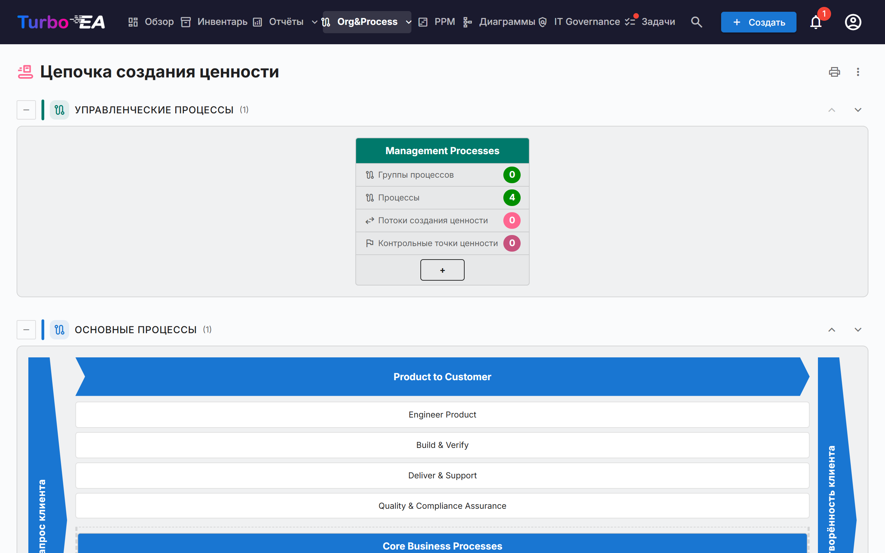
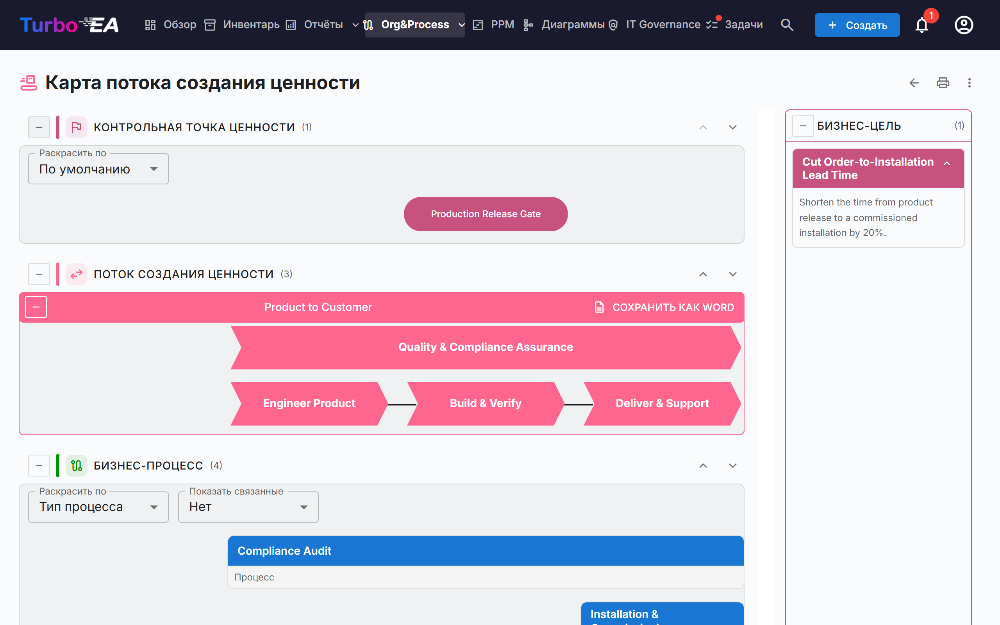

# Цепочка создания ценности и карты потоков создания ценности

Страницы **Цепочка создания ценности** и **Карта потока создания ценности** показывают в режиме только для чтения, как организация создаёт ценность: какие существуют категории процессов, как основные потоки создания ценности идут от запроса клиента до его удовлетворённости и какие процессы, возможности, цели и контрольные точки ценности стоят за каждым потоком. Обе страницы строятся по существующим карточкам — на самих страницах ничего не вводится.

!!! note
    Страницы входят в область [BPM](bpm.md). Администратор может отключить их в разделе **Админ → Настройки → Модуль BPM** (см. [Общие настройки](../admin/settings.md#модуль-bpm)); они также скрыты, пока отключён сам BPM. Для открытия страниц нужно разрешение `bpm.value_chain`.

Откройте их через **Org&Process → Цепочка создания ценности**.

## Страница «Цепочка создания ценности»

Страница складывает четыре полосы, по одной на каждый **тип процесса**:

| Полоса | Содержимое |
|--------|------------|
| **Управленческие процессы** | Планирование, управление и контроль |
| **Основные процессы** | Потоки, создающие ценность, нарисованные в виде «дома» (см. ниже) |
| **Поддерживающие процессы** | Деятельность, поддерживающая основные процессы |
| **Процессы без типа** | Категории процессов, у которых ещё не задан *Тип процесса* |

В скобках каждая полоса показывает число своих блоков. Кнопка **Свернуть** слева от заголовка полосы сворачивает её. Стрелки вверх и вниз справа перемещают полосу; порядок общий с [навигатором процессов BPM](bpm.md#навигатор-процессов), и стрелки видят только пользователи, которые могут менять настройки (`admin.settings`).

### Блоки категорий процессов

Каждая **категория процессов** (карточка «Бизнес-процесс» с подтипом *Категория процесса*) — это блок. В его заголовке указано название категории; ниже — четыре счётчика, подсчитанные по всей иерархии под категорией:

- **Группы процессов**
- **Процессы**
- **Потоки создания ценности** — потоки, которые реализуют процессы категории
- **Контрольные точки ценности** — контрольные точки, привязанные к этим потокам

Щёлкните заголовок блока, чтобы **открыть карту потока создания ценности** этой категории.

### Дом основных процессов

Полоса основных процессов нарисована как дом: слева — граница **Запрос клиента**, справа — граница **Удовлетворённость клиента**, а между ними — шеврон для каждого основного потока верхнего уровня. Под каждым шевроном показаны его дочерние потоки в виде блоков, а затем процессы, привязанные непосредственно к потоку верхнего уровня, в виде блоков процессов. Щёлкните шеврон или блок, чтобы открыть его карточку.

В доме перечислены только потоки верхнего уровня с отметкой **Основной**. Если таких нет, страница сообщает, что основной поток создания ценности не определён.

## Карта потока создания ценности

Откройте карту из блока категории. Адрес содержит категорию (`/value-chain/value-stream?category=…`), поэтому карту можно добавить в закладки или отправить другим. Если категории не существует или вы её не видите, страница сообщает об этом; если категория ещё не связана ни с одним потоком, вместо пустой карты вы увидите подсказку.

Для каждого потока категории карта рисует до четырёх горизонтальных полос сверху вниз:

| Полоса | Что показывает |
|--------|----------------|
| **Контрольная точка ценности** | Контрольные точки (цели подтипа *Контрольная точка ценности*), привязанные к потоку, в виде «таблеток», выровненных по этапам, к которым они относятся |
| **Поток создания ценности** | Поток в виде ряда шевронов, по одному на этап (его дочерние потоки), в порядке, заданном связями *следует за*. Этапы с отметкой **Сквозной** рисуются отдельно от последовательности |
| **Бизнес-процесс** | Группы процессов и процессы, реализующие каждый этап, по одному столбцу на этап, в строках согласно **Порядку уровней** |
| **Бизнес-возможность** | Бизнес-возможности, связанные с каждым этапом |

Панель **Бизнес-цель** перечисляет цели подтипа *Бизнес-цель*, для которых данный поток является целью.

### Работа с картой

- **Сворачивание и перестановка полос.** У каждой полосы есть кнопка сворачивания и стрелки вверх/вниз. Порядок запоминается только в вашем браузере. Полосы «Контрольная точка ценности» и «Бизнес-возможность» сначала свёрнуты; разверните их кнопкой слева от заголовка.
- **Раскрасить по.** Раскрашивайте контрольные точки по **Типу цели**, а процессы — по **Типу процесса**, **Зрелости (CMMI)**, **Уровню автоматизации** или **Уровню риска**. Легенда объясняет цвета; для карточек без значения показано «Не задано».
- **Показать связанные.** Добавляет под каждым процессом маленькие метки с **Приложениями**, **Объектами данных** или **Организацией**, которые схема процесса связывает с ним. Они берутся из шагов BPMN-схемы процесса; выберите *Нет*, чтобы скрыть их.
- **Группы процессов.** Блок группы можно свернуть, чтобы скрыть дочерние элементы. Процесс со схемой BPMN показывает число шагов и кнопку **Показать схему процесса**, которая открывает предварительный просмотр, не покидая карту. Щёлкните процесс, чтобы открыть его сведения рядом с картой.
- **Описания.** Переключатель описания потока показывает или скрывает его описание.

### Экспорт

- **Сохранить как Word** (у каждого потока): файл `.docx` с диаграммой на белой странице, затем бизнес-цели и бизнес-процессы потока.
- **Меню ⋮** и кнопка печати вверху обеих страниц предлагают **Печать / Сохранить как PDF**, **Excel** и **PowerPoint**. Таблицы перечисляют категории, потоки, процессы, контрольные точки, возможности и цели с переведёнными названиями.

## Подготовка данных

Страницы читают перечисленные ниже карточки. Ни одна из них не нужна для открытия страниц, но каждая дополняет часть картины.

| Чтобы получить… | Сделайте так |
|-----------------|--------------|
| Блок для каждой категории процессов | Создайте карточки «Бизнес-процесс» подтипа **Категория процесса** и задайте их **Тип процесса** (Основной, Поддерживающий, Управленческий) |
| Потоки создания ценности для категории | Создайте карточки «Бизнес-контекст» подтипа **Поток создания ценности** и свяжите с ними процессы категории связью **реализует** (Бизнес-процесс → Бизнес-контекст) |
| Этапы потока | Задайте потоку дочерние потоки (его иерархию); упорядочите их связью **следует за** и отметьте **Сквозной** у тех, что пересекают все остальные |
| Дом основных процессов | Отметьте **Основной** у потоков верхнего уровня; **Порядок сортировки** упорядочивает этапы без связи *следует за* |
| Контрольные точки и цели | Создайте карточки «Цель» подтипов **Контрольная точка ценности** или **Бизнес-цель** и свяжите их с потоком связью **является целью для** |
| Процессы под этапом | Свяжите карточки «Бизнес-процесс» с этапом связью **реализует**; **Порядок уровней** задаёт строку процесса |
| Возможности | Свяжите карточки «Бизнес-возможность» с этапами связью **связан с** |

Метамодель по умолчанию уже содержит эти поля, подтипы и связи; экземпляры, созданные до этого выпуска, получают их автоматической миграцией.

## Кто что видит

- Разрешение `bpm.value_chain` действует только на чтение. Роли Viewer, Member и BPM Admin получают его по умолчанию, администраторы имеют его неявно. Разрешения на редактирование карт нет: редактируйте исходные карточки.
- Без разрешения `bpm.view` страницы открываются, но число шагов процессов показывается как нуль, а *Показать связанные* остаётся пустым.
- Карточки, скрытые от вас вашей ролью, на картах не показываются.

!!! tip
    Те же данные доступны ИИ-ассистентам через MCP-инструмент `get_value_chain` — см. [Интеграция MCP](../admin/mcp.md).
