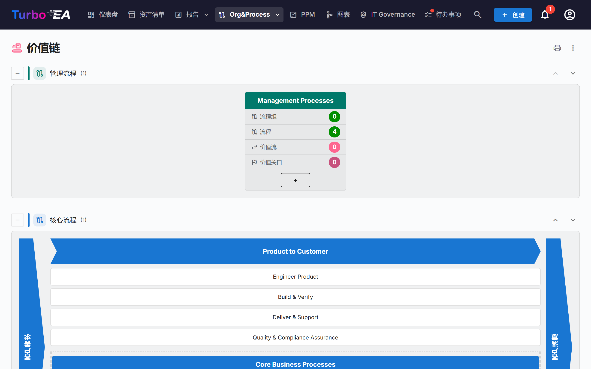
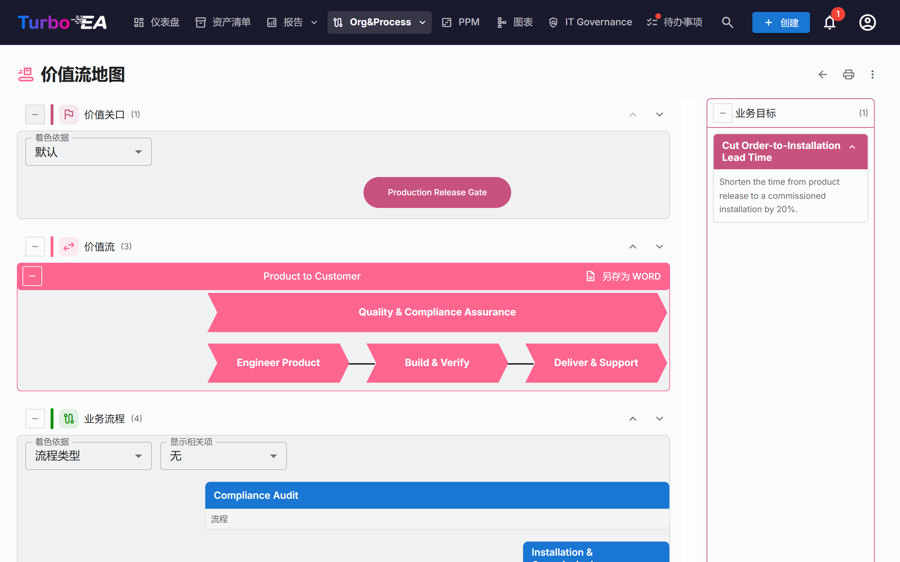

# 价值链与价值流地图

**价值链**页面和**价值流地图**页面以只读方式展示组织如何创造价值：存在哪些流程类别，核心价值流如何从客户需求一直延伸到客户满意，以及每条价值流背后有哪些流程、能力、目标和价值关口。两个页面都由现有卡片绘制，无需在页面上录入任何内容。

!!! note
    这两个页面属于 [BPM](bpm.md) 区域。管理员可以在 **管理 → 设置 → BPM 模块**中关闭它们（参见[常规设置](../admin/settings.md#bpm-模块)）；当 BPM 本身被关闭时，它们同样会被隐藏。打开页面需要权限`bpm.value_chain`。

通过 **Org&Process → 价值链**打开。

## 价值链页面

页面纵向堆叠四个条带，每个**流程类型**一个：

| 条带 | 内容 |
|------|------|
| **管理流程** | 规划、治理与控制 |
| **核心流程** | 创造价值的价值流，绘制成一座“房子”（见下文） |
| **支持流程** | 保障核心运转的活动 |
| **未设置类型的流程** | *流程类型*尚未设置的流程类别 |

每个条带的括号中显示其方框数量。点击条带标题左侧的**折叠**按钮可将其收起。右侧的上、下箭头用于移动条带；顺序与 [BPM 流程导航器](bpm.md#流程导航器)共享，只有可以修改设置的用户（`admin.settings`）才能看到箭头。

### 流程类别方框

每个**流程类别**（子类型为*流程类别*的业务流程卡片）是一个方框。方框标题显示类别名称；下方是四个计数，按该类别下的整个层级计算：

- **流程组**
- **流程**
- **价值流**：该类别的流程所实现的价值流
- **价值关口**：挂在这些价值流上的价值关口

点击方框标题即可**打开该类别的价值流地图**。

### 核心之家

核心条带绘制成一座房子：左侧是**客户需求**端，右侧是**客户满意**端，中间为每条顶层核心价值流各绘制一个箭头块。每个箭头块下方以方框列出其子价值流，随后以流程方框列出直接关联到顶层价值流的流程。点击箭头块或方框可打开对应卡片。

房子只列出标记为**是否核心**的顶层价值流。如果没有，页面会提示尚未定义核心价值流。

## 价值流地图

从类别方框打开地图。地址中包含类别（`/value-chain/value-stream?category=…`），因此地图可以加入书签或分享。如果类别不存在或您无权查看，页面会给出说明；如果该类别尚未关联任何价值流，则显示提示而不是空白地图。

对于该类别的每条价值流，地图最多绘制四个水平条带，自上而下依次为：

| 条带 | 显示内容 |
|------|----------|
| **价值关口** | 挂在价值流上的价值关口（子类型为*价值关卡*的目标），以药丸形状与其所属阶段对齐 |
| **价值流** | 价值流本身，以一排箭头块表示，每个阶段（其子价值流）一个，顺序由*继承*关系决定。标记为**是否横向**的阶段不在序列中，单独绘制 |
| **业务流程** | 实现每个阶段的流程组和流程，每个阶段一列，按**层级顺序**排成行 |
| **业务能力** | 与每个阶段关联的业务能力 |

**业务目标**面板列出以该价值流为目标的、子类型为*业务目标*的目标。

### 使用地图

- **折叠与重排条带。**每个条带都有折叠按钮和上、下箭头。顺序只保存在您的浏览器中。价值关口和业务能力条带初始处于折叠状态；用标题左侧的按钮将其展开。
- **着色依据。**价值关口可按**目标类型**着色，流程可按**流程类型**、**成熟度 (CMMI)**、**自动化水平**或**风险级别**着色。图例说明各颜色含义，没有值的卡片显示“未设置”。
- **显示相关项。**在每个流程下方以小标签显示该流程的流程图所关联的**应用**、**数据对象**或**组织**。它们来自流程 BPMN 流程图的步骤；选择*无*可将其隐藏。
- **流程组。**组方框可以折叠以隐藏其子项。带有 BPMN 流程图的流程会显示其步骤数和**查看流程图**按钮，可在不离开地图的情况下预览流程图。点击流程可在地图旁打开其详情。
- **描述。**价值流的描述开关可显示或隐藏其描述。

### 导出

- **另存为 Word**（位于每条价值流上）：一个 `.docx` 文件，白色页面上是图示，随后是该价值流的业务目标和业务流程。
- 两个页面顶部的 **⋮ 菜单**和打印按钮提供**打印 / 另存为 PDF**、**Excel** 和 **PowerPoint**。表格列出类别、价值流、流程、价值关口、能力和目标，并使用已翻译的标签。

## 准备数据

页面读取下列卡片。打开页面并不需要其中任何一项，但每一项都会补全图景的一部分。

| 要得到… | 做法 |
|---------|------|
| 每个流程类别一个方框 | 创建子类型为**流程类别**的业务流程卡片，并设置其**流程类型**（核心、支持、管理） |
| 某个类别的价值流 | 创建子类型为**价值流**的业务上下文卡片，并用**实现**关系把该类别的流程关联到它们（业务流程 → 业务上下文） |
| 价值流的阶段 | 为价值流建立子价值流（其层级）；用**继承**关系排序，并在横穿所有其他阶段的阶段上勾选**是否横向** |
| 核心之家 | 在顶层价值流上勾选**是否核心**；**排序顺序**用于排列没有*继承*关系的阶段 |
| 价值关口与目标 | 创建子类型为**价值关卡**或**业务目标**的目标卡片，并用**是其目标**关系把它们关联到价值流 |
| 阶段下的流程 | 用**实现**关系把业务流程卡片关联到阶段；**层级顺序**决定流程所在的行 |
| 能力 | 用**关联于**关系把业务能力卡片关联到阶段 |

默认元模型已包含这些字段、子类型和关系；在此版本之前创建的实例会通过自动迁移获得它们。

## 谁能看到什么

- 权限`bpm.value_chain`是只读的。Viewer、Member 和 BPM Admin 角色默认拥有该权限，管理员隐式拥有。不存在编辑地图的权限：请编辑底层卡片。
- 没有`bpm.view` 权限时，页面可以打开，但流程的步骤数显示为零，*显示相关项*保持为空。
- 您的角色对您隐藏的卡片不会出现在地图中。

!!! tip
    AI 助手可以通过 MCP 工具 `get_value_chain` 获取相同的数据——参见 [MCP 集成](../admin/mcp.md)。
